<!--
Proxymon documentation
FILE: README.md
-->
# [Proxy Monitor](https://github.com/maravento)

[](https://github.com/maravento/proxymon)
[](https://github.com/maravento/proxymon)
[](https://github.com/maravento/proxymon/stargazers)
[](https://twitter.com/maraventostudio)

<table width="100%">
  <tr>
    <td style="width: 50%; vertical-align: top;">
      <p>Businesses and institutions need to understand how users on their local area networks (LANs) use the Internet. This information helps administrators manage available resources and apply access policies.</p>
      <p><strong>Proxy Monitor</strong> is a web dashboard for monitoring traffic through <a href="https://www.squid-cache.org/" target="_blank">Squid-Cache</a>. It integrates <strong>Squidmon</strong> for real-time traffic monitoring, <strong>Squidreports</strong> for historical reports on user data usage, frequently visited sites and blocked requests, <strong>Logview</strong> for viewing logs, and <strong>SquidAI</strong> for querying them through questions in English or Spanish, among other features.</p>
      <p>It also includes <strong>Bandata</strong>, an additional tool for applying daily, weekly and monthly data usage limits, blocking devices that exceed their quotas and redirecting their requests to a warning page.</p>
      <p>Proxy Monitor runs on Linux with <a href="https://httpd.apache.org/" target="_blank">Apache2</a>. Its reports cover only traffic that passes through Squid.</p>
    </td>
    <td style="width: 50%; vertical-align: top;">
      <p>Las empresas e instituciones necesitan conocer cómo utilizan Internet los usuarios de su red local (LAN). Esta información ayuda a administrar los recursos disponibles y aplicar políticas de acceso.</p>
      <p><strong>Proxy Monitor</strong> es un panel web para supervisar el tráfico de <a href="https://www.squid-cache.org/" target="_blank">Squid-Cache</a>. Integra <strong>Squidmon</strong> para supervisar el tráfico en tiempo real, <strong>Squidreports</strong> para consultar informes históricos de consumo por usuario, sitios más visitados y solicitudes bloqueadas, <strong>Logview</strong> para visualizar registros y <strong>SquidAI</strong> para consultarlos mediante preguntas en español o inglés, entre otras funciones.</p>
      <p>También cuenta con <strong>Bandata</strong>, una herramienta adicional para aplicar límites de consumo diarios, semanales y mensuales, bloquear los equipos que superan sus cuotas y redirigir sus solicitudes a una página de aviso.</p>
      <p>Proxy Monitor funciona en Linux con <a href="https://httpd.apache.org/" target="_blank">Apache2</a>. Sus informes incluyen únicamente el tráfico que pasa por Squid.</p>
    </td>
  </tr>
</table>

<!-- markdownlint-disable MD033 -->

## REQUIREMENTS

---

### ⚠️ Warning

WARNING: Only tested on Ubuntu 24.04/26.04 LTS. Other versions or distributions are not tested and are used at your own risk.

|   CPU   |   RAM   |   Storage   |   Dependencies   |
| :-----: | :-----: | :---------: | :--------------: |
| Intel Core i5/Xeon/AMD Ryzen 5 (≥ 3.0 GHz) | 16 GB | 2 GB SSD | Squid Cache v6.13, Apache v2.4.58, PHP 8.3.6 |

<table width="100%">
  <tr>
    <td style="width: 50%; vertical-align: top;">
      <p>• <code>pmsetup.sh</code> installs Apache, PHP and <code>libjson-xs-perl</code> when they are missing. It also installs <code>squid-openssl</code>, the flavour that supports SSL bump, when no Squid is present.<br><br>• An existing Squid is left untouched, including its <code>squid.conf</code>. Only a Squid installed by the installer receives the bundled template.<br><br>• The installer sets weekly rotation in <code>/etc/logrotate.d/squid</code> in both cases.<br><br>• Install the supporting packages below before running <code>pmsetup.sh</code>. It checks them and stops at the first missing package.<br><br>• The Squid, PHP and Apache blocks below are optional tuning, not prerequisites.</p>
    </td>
    <td style="width: 50%; vertical-align: top;">
      <p>• <code>pmsetup.sh</code> instala Apache, PHP y <code>libjson-xs-perl</code> cuando faltan. También instala <code>squid-openssl</code>, la variante que admite SSL bump, cuando no hay ningún Squid presente.<br><br>• Un Squid existente no se modifica, tampoco su <code>squid.conf</code>. Solo un Squid instalado por el instalador recibe la plantilla incluida.<br><br>• El instalador fija la rotación semanal en <code>/etc/logrotate.d/squid</code> en ambos casos.<br><br>• Instale los paquetes auxiliares de abajo antes de ejecutar <code>pmsetup.sh</code>. Los comprueba y se detiene al encontrar el primer paquete ausente.<br><br>• Los bloques de Squid, PHP y Apache de abajo son ajustes opcionales, no requisitos.</p>
    </td>
  </tr>
</table>

```bash
# other required packages (checked by pmsetup.sh, no extra setup needed)
apt install -y wget curl git zip unzip ipset nbtscan libcgi-session-perl libgd-perl libjson-xs-perl \
                coreutils fonts-lato fonts-liberation fonts-dejavu \
                perl cron sudo util-linux iproute2 passwd findutils sed \
                grep hostname ncurses-bin systemd libc-bin iptables \
                gawk gzip procps logrotate

# squid
apt install -y squid-openssl squid-langpack squid-common squidclient squid-purge
mkdir -p /var/log/squid &>/dev/null
touch /var/log/squid/{access,cache,store,deny}.log &>/dev/null
chown proxy:proxy /var/log/squid/*.log
chmod 640 /var/log/squid/*.log
for cache_type in rock ufs; do
    mkdir -p /var/spool/squid/${cache_type} 2>/dev/null
done
chown -R proxy:proxy /var/spool/squid
chmod -R 700 /var/spool/squid
usermod -aG proxy www-data
systemctl enable squid.service
squid -z
cp -f /etc/logrotate.d/squid{,.bak} &>/dev/null
sed -i '/sharedscripts/a \    create 0644 proxy proxy' /etc/logrotate.d/squid
sed -i 's/rotate 2/rotate 7/' /etc/logrotate.d/squid
sed -i -E 's/^([[:space:]]*)(hourly|daily|monthly|yearly)$/\1weekly/' /etc/logrotate.d/squid

# php
apt install -y php libapache2-mod-php php-cli php-curl
# Detect PHP version
if command -v php &>/dev/null; then
    PHP_VERSION=$(php -r "echo PHP_MAJOR_VERSION.'.'.PHP_MINOR_VERSION;" 2>/dev/null)
    echo "PHP version detected: $PHP_VERSION"
else
    echo "Error: PHP not installed"
    exit 1
fi
# Ensure php.ini exists for Apache
if [ ! -f /etc/php/$PHP_VERSION/apache2/php.ini ]; then
    if [ -f /etc/php/$PHP_VERSION/cli/php.ini ]; then
        mkdir -p /etc/php/$PHP_VERSION/apache2
        cp /etc/php/$PHP_VERSION/cli/php.ini /etc/php/$PHP_VERSION/apache2/php.ini
        echo "php.ini copied to /etc/php/$PHP_VERSION/apache2/"
    else
        echo "Error: php.ini not found"
        exit 1
    fi
fi
cp -f /etc/php/$PHP_VERSION/apache2/php.ini{,.bak} &>/dev/null
sed -i \
  -e 's/^\s*;*\s*max_execution_time\s*=.*/max_execution_time = 120/' \
  -e 's/^\s*max_input_time\s*=.*/max_input_time = 120/' \
  -e 's/^;\s*max_input_time\s*=.*/max_input_time = 120/' \
  -e 's/^\s*memory_limit\s*=.*/memory_limit = 1024M/' \
  -e 's/^\s*post_max_size\s*=.*/post_max_size = 64M/' \
  -e 's/^\s*upload_max_filesize\s*=.*/upload_max_filesize = 64M/' \
  -e 's/^\s*;*\s*opcache.memory_consumption\s*=.*/opcache.memory_consumption = 256/' \
  -e 's/^\s*;*\s*realpath_cache_size\s*=.*/realpath_cache_size = 16M/' \
  /etc/php/$PHP_VERSION/apache2/php.ini

# apache
apt install -y apache2 apache2-doc apache2-utils apache2-dev \
                apache2-suexec-pristine libaprutil1t64 libaprutil1-dev \
                libtest-fatal-perl
systemctl enable apache2.service
apt -qq install -y --reinstall apache2-doc
cp -f /etc/apache2/mods-available/mpm_prefork.conf{,.bak} &>/dev/null
sed -i \
  -e 's/^\(StartServers[[:space:]]*\)5/\110/' \
  -e 's/^\(MinSpareServers[[:space:]]*\)5/\110/' \
  -e 's/^\(MaxSpareServers[[:space:]]*\)10/\115/' \
  -e 's/^\(MaxRequestWorkers[[:space:]]*\)150/\1200/' \
  -e 's/^\(MaxConnectionsPerChild[[:space:]]*\)0/\11000/' \
  /etc/apache2/mods-available/mpm_prefork.conf
# Enable modules
a2dismod -q mpm_event || true
a2enmod -q mpm_prefork || true
a2enmod -q php || true
```

## REPOSITORY STRUCTURE

---

```
proxymon/
├── modules/                    # Web content served from /var/www/proxymon
│   ├── logview/                  # Logview: Log and Live views for access logs and active requests
│   ├── squidai/                  # AI: conversational assistant
│   ├── squidmon/                 # Monitor: real-time traffic and ACL analysis
│   ├── squidreports/             # Reports: daily traffic reports
│   ├── warning/                  # Captive portal warning page
│   └── index.html                # Main page with the module tabs
├── config/                     # Root-only files, installed to /etc/proxymon
│   ├── bandata/                  # Data usage control (bandata.sh and its ACLs)
│   ├── tools/                    # Maintenance scripts
│   │   ├── pmbk.sh               # Backup tool
│   │   ├── proxymonenv.sh        # Shared configuration reader; sourced, not executed
│   │   └── squidtool.sh          # Log search and traffic reports
│   ├── squid/                    # squid.conf template, deployed only on a fresh Squid
│   └── vhost/                    # Apache vhosts, installed to sites-available
└── pmsetup.sh                  # Installer: install, update, uninstall
```

## HOW TO USE

---

```bash
git clone --depth=1 https://github.com/maravento/proxymon.git
cd proxymon

# Install
sudo bash pmsetup.sh --install

# Update
sudo bash pmsetup.sh --update

# Uninstall
sudo bash pmsetup.sh --uninstall

# Interactive menu
sudo bash pmsetup.sh

# Help
sudo bash pmsetup.sh --help   # or -h
```

### Before You Begin

<table width="100%">
  <tr>
    <td style="width: 50%; vertical-align: top;">
      <p>• Traffic that bypasses Squid does not appear in its reports.<br><br>• The results in <strong>Squidmon Search</strong> and <strong>Traffic Search</strong> are examples. Actual results vary with your environment, the amount of log history, and the resources available to process ACLs.</p>
    </td>
    <td style="width: 50%; vertical-align: top;">
      <p>• El tráfico que no pase por Squid no aparecerá en sus informes.<br><br>• Los resultados de <strong>Squidmon Search</strong> y <strong>Traffic Search</strong> son ejemplos. Los resultados reales dependen del entorno, la cantidad de registros históricos y los recursos disponibles para procesar las ACL.</p>
    </td>
  </tr>
</table>

### Installer Options

| Command | Description | Descripción |
| --- | --- | --- |
| `sudo ./pmsetup.sh` | Opens the interactive menu with options to install, update, uninstall or exit. | Abre el menú interactivo con opciones para instalar, actualizar, desinstalar o salir. |
| `sudo ./pmsetup.sh --install` | Installs and configures Proxy Monitor, including Apache rules, `proxymon.env`, ACL lists, Apache and PHP settings, and scheduled tasks. Stops if the configured `WEB_ROOT` already exists; use `--update` or `--uninstall` in that case. | Instala y configura Proxy Monitor, incluidas las reglas de Apache, `proxymon.env`, las listas ACL, los ajustes de Apache y PHP y las tareas programadas. Se detiene si el directorio configurado en `WEB_ROOT` ya existe; en ese caso, use `--update` o `--uninstall`. |
| `sudo ./pmsetup.sh --update` | Updates code and permissions without prompting for input. Preserves configuration and operational data. | Actualiza el código y los permisos sin solicitar datos. Conserva la configuración y los datos de operación. |
| `sudo ./pmsetup.sh --uninstall` | Requests confirmation before uninstalling Proxy Monitor. | Solicita confirmación antes de desinstalar Proxy Monitor. |
| `sudo ./pmsetup.sh -h` / `sudo ./pmsetup.sh --help` | Displays help with the available installer options. | Muestra la ayuda con las opciones disponibles del instalador. |

#### ⚠️ Warning

<table width="100%">
  <tr>
    <td style="width: 50%; vertical-align: top;">
      Do not interrupt an update with Ctrl-C. Apache remains stopped during the process. The installer attempts to restart it on exit, but an interruption may leave the service stopped and the update incomplete. If it happens, start Apache with <code>sudo systemctl start apache2</code> and run the update again.
    </td>
    <td style="width: 50%; vertical-align: top;">
      No interrumpa una actualización con Ctrl-C. Apache permanece detenido durante el proceso. El instalador intenta iniciarlo al salir, pero una interrupción puede dejar el servicio detenido y la actualización incompleta. Si ocurre, inicie Apache con <code>sudo systemctl start apache2</code> y repita la actualización.
    </td>
  </tr>
</table>

> Uninstall preserves the shared ACL directory (`ACL_PATH`, `/etc/acl` by default). It does not offer to delete it.
>
> La desinstalación conserva el directorio compartido de ACL (`ACL_PATH`, `/etc/acl` por defecto). No ofrece eliminarlo.

> After uninstalling, restart the computer to clear any remaining temporary Bandata rules.
>
> Después de desinstalar, reinicie el equipo para eliminar las reglas temporales de Bandata restantes.

#### `update` Behavior

| Description | Descripción |
| --- | --- |
| • `update` updates the web content under `WEB_ROOT`, the root scripts under `CONFIG_DIR` and their permissions.<br><br>• Preserves PHP configuration, ACL lists and both configuration files (`proxymon.env` and the LLM `.env`) unchanged. Applies these values to Apache paths, Listen directives and the parser, Bandata and backup cron entries; retains other virtualhost directives.<br><br>• Stops Apache, creates a backup with `pmbk.sh`, replaces the code and restarts Apache.<br><br>• Application code and its directories are owned by `root`; preserved data and configuration retain their ownership.<br><br>• Does not change the ownership or permissions of the shared `/var/www` directory.<br><br>• Rejects symbolic links in code directories and replaces code files without following destination links.<br><br>• The copy excludes the preserved files and directories listed below. | • `update` actualiza el contenido web de `WEB_ROOT`, los scripts ejecutados como root de `CONFIG_DIR` y sus permisos.<br><br>• Conserva la configuración de PHP, las listas ACL y ambos archivos de configuración (`proxymon.env` y `.env` del LLM) sin modificaciones. Aplica estos valores a las rutas de Apache, sus directivas Listen y las entradas de cron del parser, Bandata y copias; mantiene las demás directivas de los virtualhosts.<br><br>• Detiene Apache, crea una copia de seguridad con `pmbk.sh`, reemplaza el código y vuelve a iniciar Apache.<br><br>• El código de la aplicación y sus directorios pertenecen a `root`; los datos y la configuración preservados conservan sus propietarios.<br><br>• No cambia el propietario ni los permisos del directorio compartido `/var/www`.<br><br>• Rechaza enlaces simbólicos en directorios de código y reemplaza archivos de código sin seguir enlaces de destino.<br><br>• La copia excluye los archivos y directorios preservados que se enumeran a continuación. |

| Path | Description | Descripción |
| ---- | ------------ | ----------- |
| `squidreports/report` | Daily Squidreports reports | Informes diarios de Squidreports |
| `squidreports/reportstats` | Additional statistics; preserved by `update` and included in the `pmbk.sh` backup | Estadísticas adicionales; conservadas por `update` e incluidas en la copia de `pmbk.sh` |
| `squidreports/realname.cfg` | Hostname mappings | Correspondencia entre IP y nombres de equipo |
| `squidreports/skipuser.cfg` | Excluded users | Usuarios excluidos |
| `squidreports/squidreports.cfg` | Squidreports configuration | Configuración de Squidreports |
| `squidreports/group.cfg` | User groups | Grupos de usuarios |
| `squidmon/etc/config` | Squidmon configuration file | Archivo de configuración de Squidmon |
| `warning/warning.html` | Captive portal warning page | Página de aviso del portal cautivo |
| `/etc/proxymon/bandata/acl` | Bandata quota lists | Listas de cuota de Bandata |

<b>Access Proxymon</b>: [http://localhost:18080](http://localhost:18080)

<b>Warning for Bandata</b>: `http://SERVER_IP:18081`

### proxymon.env

#### ⚠️ Warning

<table width="100%">
  <tr>
    <td style="width: 50%; vertical-align: top;">
      <p>Changing the default values in <code>proxymon.env</code> is at the sysadmin's own risk.</p>
    </td>
    <td style="width: 50%; vertical-align: top;">
      <p>El administrador del sistema cambia los valores predeterminados de <code>proxymon.env</code> bajo su propia responsabilidad.</p>
    </td>
  </tr>
</table>

#### Keys

<table width="100%">
  <tr>
    <td style="width: 50%; vertical-align: top;">
      <p>Keys are grouped by use: General, Network, Squid, ACL, Squidreports, Squidmon, SquidAI, Squidtool, Bandata and Backup. Installation generates this layout; <code>update</code> leaves <code>.env</code> unchanged. All keys precede the final separator.</p>
      <p>• <code>pmsetup.sh</code> creates <code>/etc/proxymon/proxymon.env</code> during installation.<br><br>• It provides shared settings for <code>bandata.sh</code>, <code>squidtool.sh</code>, <code>logview/api.php</code>, <code>logview/connections.php</code>, <code>squidai/worker.php</code>, Squidreports, Squidmon and <code>pmbk.sh</code>.<br><br>• Installation generates the keys. Existing configuration files must be adjusted manually when new keys are needed.<br><br>• The <code>update</code> option preserves its existing values.</p>
    </td>
    <td style="width: 50%; vertical-align: top;">
      <p>Las claves se agrupan por uso: General, Network, Squid, ACL, Squidreports, Squidmon, SquidAI, Squidtool, Bandata y Backup. La instalación genera esta estructura; <code>update</code> conserva <code>.env</code> sin modificaciones. Todas las claves preceden al separador final.</p>
      <p>• <code>pmsetup.sh</code> crea <code>/etc/proxymon/proxymon.env</code> durante la instalación.<br><br>• Contiene la configuración compartida que utilizan <code>bandata.sh</code>, <code>squidtool.sh</code>, <code>logview/api.php</code>, <code>logview/connections.php</code>, <code>squidai/worker.php</code>, Squidreports, Squidmon y <code>pmbk.sh</code>.<br><br>• La instalación genera las claves. Los archivos de configuración existentes deben ajustarse manualmente cuando se necesitan claves nuevas.<br><br>• La opción <code>update</code> conserva sus valores existentes.</p>
    </td>
  </tr>
</table>

| Variable | Read by | Description | Descripción |
|----------|---------|--------------|-------------|
| `WEB_ROOT`, `CONFIG_DIR` | `pmsetup.sh`, `pmbk.sh` | Web application and root-script directories. Defaults: `/var/www/proxymon` and `/etc/proxymon`. | Directorios de la aplicación web y los scripts de root. Valores iniciales: `/var/www/proxymon` y `/etc/proxymon`. |
| `PANEL_PORT`, `WARNING_PORT` | `pmsetup.sh`, `squidtool.sh`, `worker.php`, `bandata.sh` | Panel and warning ports. Defaults: `18080` and `18081`. Apache keeps the panel on loopback and the warning page on `SERVER_IP`. | Puertos del panel y los avisos. Valores iniciales: `18080` y `18081`. Apache mantiene el panel en localhost y los avisos en `SERVER_IP`. |
| `BACKUP_DIR` | `pmbk.sh` | Backup destination. Default: `/etc/bak/proxymon`. | Destino de las copias de seguridad. Valor inicial: `/etc/bak/proxymon`. |
| `TOOL_REPORT_DIR` | `pmsetup.sh`, `squidtool.sh`, `pmbk.sh` | Directory for generated traffic and log-search HTML reports, served through Apache's Squidtool alias. | Directorio de informes HTML de tráfico y búsqueda, publicado mediante el alias Squidtool de Apache. |
| `SQUIDTOOL_MIN_HITS` | `squidtool.sh` | Minimum requests per row in traffic reports without an IP filter. Default: `20`, written automatically without a prompt. Changing this default is not recommended. Reports for one IP show all rows. Accepts nonnegative integers without leading zeros. | Mínimo de solicitudes por fila en informes de tráfico sin filtro de IP. Valor inicial: `20`, escrito automáticamente sin preguntas. No se recomienda modificar este valor. Los informes de una IP muestran todas las filas. Acepta enteros no negativos sin ceros iniciales. |
| `SQUIDTOOL_ALERT_THRESHOLD` | `squidtool.sh` | Request threshold for highlighting and counting traffic rows as alerts. Default: `300`, written automatically without a prompt. Changing this default is not recommended. Accepts nonnegative integers without leading zeros. | Umbral de solicitudes para resaltar y contar filas de tráfico como alertas. Valor inicial: `300`, escrito automáticamente sin preguntas. No se recomienda modificar este valor. Acepta enteros no negativos sin ceros iniciales. |
| `SQUIDMON_CONFIG` | `pmsetup.sh`, Squidmon, `pmbk.sh` | Squidmon settings file. Its log source comes from `SQUID_LOG_FILE`. | Archivo de configuración de Squidmon. Su registro de origen proviene de `SQUID_LOG_FILE`. |
| `LLM_ENV_FILE` | `pmsetup.sh`, `worker.php`, `pmbk.sh` | SquidAI credential file. Default: `/etc/proxymon/.env`. | Archivo de credenciales de SquidAI. Valor inicial: `/etc/proxymon/.env`. |
| `REPORT_STATS_PATH` | `pmsetup.sh`, Squidreports, SquidAI, `pmbk.sh` | Additional Detail and Analyze statistics. Default: the original report directory followed by `stats`. Remains separate from Bandata's original reports. | Estadísticas adicionales de Detail y Analyze. Valor inicial: directorio de informes originales seguido de `stats`. Permanece separado de los informes originales utilizados por Bandata. |
| `LAN` | `bandata.sh` | LAN interface the quota rules apply to | Interfaz LAN a la que se aplican las reglas de cuota |
| `SERVER_IP` | `pmsetup.sh`, `worker.php` | Server's own IPv4; excluded from the reports | IPv4 del servidor; se excluye de los informes |
| `RANGE` | `pmsetup.sh`, `squidreports.pl`, `analytics.cgi` | LAN network in CIDR notation. Used by Analyze and regenerated subnet statistics. Unmatched addresses remain individual. Missing, empty or invalid values stop these consumers. Does not configure Apache access. | Red LAN en formato CIDR. La utilizan Analyze y las estadísticas por subred regeneradas. Las direcciones sin coincidencia permanecen individuales. Un valor ausente, vacío o inválido detiene estos consumidores. No configura el acceso de Apache. |
| `REPORT_IP_GLOB` | `bandata.sh` | Glob that matches the client IPs inside a Squidreports report | Patrón de nombres de archivo que selecciona las IP de cliente en los informes de Squidreports |
| `SQUIDREPORTS_DIR` | `bandata.sh`, Squidreports | Squidreports installation directory | Directorio de instalación de Squidreports |
| `REPORT_PATH` | `bandata.sh`, `worker.php`, Squidreports, `pmbk.sh` | Directory holding the daily Squidreports reports | Directorio con los informes diarios de Squidreports |
| `REALNAME_CFG`, `SKIPUSERS_CFG` | `bandata.sh`, `worker.php`, Squidreports | Squidreports hostname mappings and excluded-user list | Correspondencia entre IP y nombres de equipo, y lista de usuarios excluidos de Squidreports |
| `ACL_PATH`, `ACL_MAC_PATH`, `ACL_SQUID_PATH` | `pmsetup.sh`, `bandata.sh`, `worker.php` | ACL tree shared with the other projects on the host, and its MAC and Squid branches | Árbol de ACL compartido con los otros proyectos del host, y sus ramas MAC y Squid |
| `ACL_BANDATA_PATH` | `bandata.sh` | Directory holding Bandata's own quota lists | Directorio con las listas de cuota propias de Bandata |
| `ALLOW_LIST` | `bandata.sh` | IPs exempt from every quota | IP exentas de toda cuota |
| `BLOCK_LIST_DAY`, `BLOCK_LIST_WEEK`, `BLOCK_LIST_MONTH` | `bandata.sh` | The three lists Bandata rewrites, one per quota window | Las tres listas que Bandata reescribe, una por ventana de cuota |
| `SQUID_LOG_DIR`, `SQUID_LOG_FILE` | `pmsetup.sh`, `squidtool.sh`, `api.php`, `worker.php`, Squidreports, Squidmon | Squid log directory and `access.log` path | Directorio de logs de Squid y ruta de `access.log` |
| `SQUID_MGR_HOST`, `SQUID_MGR_PORT` | `connections.php` | Where Squid's cache manager answers; Logview reads the requests in flight from it. `SQUID_MGR_PORT` defaults to `3128` and is shared with other projects | Dirección y puerto del administrador de caché de Squid; Logview consulta allí las solicitudes en curso. `SQUID_MGR_PORT` tiene valor inicial `3128` y se comparte con otros proyectos |
| `SQUID_INTERCEPT_PORT` | Other projects | Squid intercept port, default `3129`. Shared key for other projects. | Puerto transparente de Squid, valor inicial `3129`. Clave compartida para otros proyectos. |
| `SQUID_MGR_PASSWD` | `connections.php` | Empty by default. Set it only if `squid.conf` declares `cachemgr_passwd mypassword all`, and use the very same value | Vacía de forma predeterminada. Defínala únicamente si `squid.conf` declara `cachemgr_passwd mipassword all`, y utilice el mismo valor |
| `WARNING_HTML` | `bandata.sh` | Captive portal page where Bandata writes the current quota values | Página del portal cautivo donde Bandata escribe los valores de cuota vigentes |
| `CACHE_PATH` | `pmsetup.sh`, `worker.php` | SquidAI cache directory, owned by `www-data` with mode `750` | Directorio de caché de SquidAI, propiedad de `www-data` con permisos `750` |
| `MAX_BANDWIDTH_DAY`, `MAX_BANDWIDTH_WEEK`, `MAX_BANDWIDTH_MONTH` | `bandata.sh` | The three quota limits; see Bandata below | Los tres límites de cuota; consulte Bandata |
| `BANDATA_HOTSPOT`, `HOTSPOT_PATH` | `bandata.sh` | Whether a UniFi hotspot is in use, and where its files live | Si hay un hotspot UniFi en uso, y la ubicación de sus archivos |
| `UPDATE_REALNAME` | `bandata.sh` | Whether Bandata refreshes Squidreports' names, exclusions and ACL groups on each run | Indica si Bandata actualiza los nombres, exclusiones y grupos por ACL de Squidreports en cada ejecución |

#### Configuration

| Description | Descripción |
| --- | --- |
| • The installer establishes paths and ports in `proxymon.env`. Runtime modules read these settings; legacy paths in preserved `squidreports.cfg` files no longer override them. Configure Squidmon's log source through `SQUID_LOG_FILE`; its form displays this value read-only.<br><br>• Run `pmsetup.sh --update` after changing ports to apply Apache's configuration. Changing a data path does not move existing files: relocate the data and retain its permissions before using the new path. `pmbk.sh` backs up the configured original reports and additional statistics.<br><br>• `/etc/proxymon/proxymon.env` remains the fixed configuration entry point. Installation defaults are declared by the installer. Project-relative library paths and operating-system paths remain independent of environment settings.<br><br>• The installation sets two fixed Squid ports: `3128` for the cache and `3129` for intercept. `SQUID_MGR_PORT` and `SQUID_INTERCEPT_PORT` record these values; they do not configure Squid. To change a port, edit `proxymon.env` and `squid.conf` with the same value. | • El instalador establece las rutas y los puertos en `proxymon.env`. Los módulos leen estos valores; las rutas antiguas de archivos `squidreports.cfg` preservados ya no los reemplazan. Configure el registro de Squidmon mediante `SQUID_LOG_FILE`; su formulario muestra este valor sin permitir editarlo.<br><br>• Ejecute `pmsetup.sh --update` después de cambiar puertos para aplicar la configuración de Apache. Cambiar una ruta de datos no mueve los archivos existentes: traslade los datos y conserve sus permisos antes de utilizar la nueva ruta. `pmbk.sh` respalda los informes originales y las estadísticas adicionales configurados.<br><br>• `/etc/proxymon/proxymon.env` permanece como punto fijo de entrada a la configuración. El instalador declara los valores iniciales de instalación. Las rutas relativas de bibliotecas y las rutas del sistema operativo permanecen independientes de la configuración del entorno.<br><br>• La instalación fija dos puertos de Squid: `3128` para la caché y `3129` para intercept. `SQUID_MGR_PORT` y `SQUID_INTERCEPT_PORT` registran estos valores; no configuran Squid. Para cambiar un puerto, edite `proxymon.env` y `squid.conf` con el mismo valor. |

> `LLM_ENV_FILE` points to a second file, `.env` by default, with the SquidAI credentials `LLM_URL`, `LLM_API_KEY`, `LLM_MODEL` and `LLM_RESPONSE_FORMAT`. The installer creates this file only if absent, using a template embedded in `pmsetup.sh`. Existing content is preserved. See API Configuration.
>
> `LLM_ENV_FILE` indica un segundo archivo, `.env` por defecto, con las credenciales de SquidAI `LLM_URL`, `LLM_API_KEY`, `LLM_MODEL` y `LLM_RESPONSE_FORMAT`. El instalador crea este archivo únicamente si no existe, utilizando una plantilla incluida en `pmsetup.sh`. Conserva el contenido existente. Ver «API Configuration».

### proxymonenv.sh

<table width="100%">
  <tr>
    <td style="width: 50%; vertical-align: top;">
      <p>Shared Bash file installed at <code>CONFIG_DIR/tools/proxymonenv.sh</code>. It is loaded automatically with <code>source</code> by <code>pmsetup.sh</code>, <code>bandata.sh</code>, <code>squidtool.sh</code> and <code>pmbk.sh</code>. Do not run it separately or schedule it in cron.</p>
      <p>Provides <code>load_proxymon_env</code> to read general configuration from <code>proxymon.env</code>, resolve references between keys and check the file owner and permissions. It does not modify configuration files or load the LLM credentials file.</p>
    </td>
    <td style="width: 50%; vertical-align: top;">
      <p>Archivo Bash compartido instalado en <code>CONFIG_DIR/tools/proxymonenv.sh</code>. Lo cargan automáticamente mediante <code>source</code> los scripts <code>pmsetup.sh</code>, <code>bandata.sh</code>, <code>squidtool.sh</code> y <code>pmbk.sh</code>. No se ejecuta por separado ni se programa en cron.</p>
      <p>Proporciona <code>load_proxymon_env</code> para leer la configuración general de <code>proxymon.env</code>, resolver referencias entre claves y comprobar el propietario y los permisos del archivo. No modifica archivos de configuración ni carga el archivo de credenciales del LLM.</p>
    </td>
  </tr>
</table>

## SCOPE

| In scope | Dentro del alcance |
| --- | --- |
| Monitor and analyze traffic recorded by Squid through live views, historical reports and log queries. Reports cover only traffic that passes through Squid. | Supervisar y analizar el tráfico registrado por Squid mediante vistas en tiempo real, informes históricos y consultas de registros. Los informes incluyen únicamente el tráfico que pasa por Squid. |
| Apply daily, weekly and monthly data quotas through Bandata using Squidreports data. | Aplicar cuotas de consumo diarias, semanales y mensuales mediante Bandata utilizando los datos de Squidreports. |

| Out of scope | Fuera del alcance |
| --- | --- |
| Integration with DHCP servers or reading their configuration or leases. DHCP name resolution is unsupported because replacing IP identifiers with names can affect Bandata quotas. Display names can be associated through `realname.cfg` without replacing those identifiers. | Integración con servidores DHCP o lectura de su configuración o concesiones. La resolución de nombres mediante DHCP no está soportada porque sustituir las IP por nombres puede afectar las cuotas de Bandata. Los nombres visibles pueden asociarse mediante `realname.cfg` sin sustituir esos identificadores. |
| Monitoring traffic that does not pass through Squid. | Supervisión del tráfico que no pasa por Squid. |
| Full IPv6 support. Support is partial: Squidreports Analyze can group IPv6 client addresses using configured IPv6 CIDRs; SquidAI recognizes bracketed IPv6 literals in CONNECT destinations; the Squidmon PDF client filter accepts IPv6 address characters. These features do not provide IPv6 network configuration or IPv6 quota enforcement through Bandata. | Soporte completo de IPv6. El soporte es parcial: Squidreports Analyze puede agrupar direcciones IPv6 de clientes mediante redes CIDR IPv6 configuradas; SquidAI reconoce direcciones IPv6 entre corchetes en destinos CONNECT; el filtro de clientes del PDF de Squidmon admite caracteres de direcciones IPv6. Estas funciones no proporcionan configuración de redes IPv6 ni aplicación de cuotas IPv6 mediante Bandata. |

## MODULES

---

### MAIN MENU

<p align="center">
<a href="https://www.maravento.com/">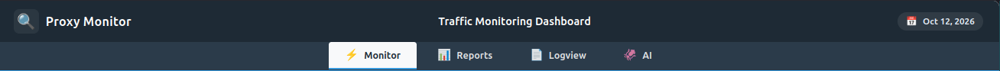</a>
</p>

### MONITOR (Squidmon)

<p align="center">
<a href="https://www.maravento.com/">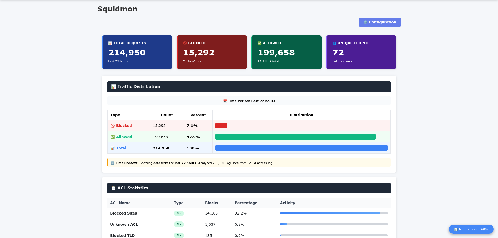</a>
</p>

<table width="100%">
  <tr>
    <td style="width: 50%; vertical-align: top;">
     Monitor (Squidmon) monitors Squid traffic in real time. It shows blocked domains and clients, traffic patterns, and ACL matches. Filter the activity to generate reports on network traffic and blocked content.
    </td>
    <td style="width: 50%; vertical-align: top;">
     Monitor (Squidmon) ofrece análisis del tráfico de Squid en tiempo real. Muestra estadísticas sobre dominios y clientes bloqueados, patrones de tráfico y coincidencias con las ACL. También permite filtrar la actividad y generar informes detallados sobre el tráfico de red y el contenido bloqueado.
    </td>
  </tr>
</table>

#### Configuration

<p align="center">
<a href="https://www.maravento.com/">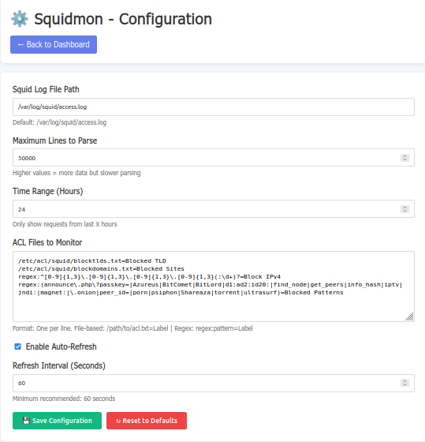</a>
</p>

<table width="100%">
  <tr>
    <td style="width: 50%; vertical-align: top;">
      This section defines the parameters that Squidmon uses to interpret and display network activity, including data sources (access control lists —ACLs—), the maximum number of lines to analyze from the Squid log, the time range of the data, and the automatic refresh interval. Each list is declared with its full path, one per line, and the module reads exactly that path: it never searches any directory. The default entries are:
    </td>
    <td style="width: 50%; vertical-align: top;">
      Aquí se configuran los parámetros que Squidmon usa para mostrar la actividad de la red: las listas de control de acceso (ACL), el máximo de líneas del registro de Squid que se analizarán, el período de consulta y el intervalo de actualización. Cada lista se declara con su ruta completa, una por línea. El módulo lee esa ruta y no busca en ningún directorio. Estas son las entradas predeterminadas:
    </td>
  </tr>
</table>

```bash
/etc/acl/squid/blocktlds.txt=Blocked TLD
/etc/acl/squid/blockdomains.txt=Blocked Sites
regex:^[0-9]{1,3}\.[0-9]{1,3}\.[0-9]{1,3}\.[0-9]{1,3}(:\d+)?(?=[/?#]|$)=Block IPv4
regex:(adlinkfly|announce\.php\?passkey=|info_hash|iptv|jndi:|mtc[0-9]|\.onion|peer_id=|porn|psiphon|torrent|ultrasurf)=Blocked Patterns
```

<table width="100%">
  <tr>
    <td style="width: 50%; vertical-align: top;">
      To change the lists, enter each full path in the <b>Config</b> section, one per line, followed by <code>=</code> and its label. Squidmon opens exactly that path and searches no directory. If you move a list, edit its line in <b>Config</b>.
    </td>
    <td style="width: 50%; vertical-align: top;">
      Para cambiar las listas, indique en la sección <b>Config</b> la ruta completa de cada archivo, una por línea, seguida de <code>=</code> y su etiqueta. Squidmon abre esa ruta y no busca en ninguna carpeta. Si cambia la ubicación de una lista, actualice su entrada en <b>Config</b>.
    </td>
  </tr>
</table>

```bash
sudo nano /etc/proxymon/proxymon.env
# path to ACLs folder
ACL_PATH=/etc/acl
```

#### ACL Rules

<table width="100%">
  <tr>
    <td style="width: 50%; vertical-align: top;">
      <p>For a rule to block traffic, it must be defined in both Squidmon configuration and <code>squid.conf</code>. Here is an example using the default ACLs:</p>
    </td>
    <td style="width: 50%; vertical-align: top;">
      <p>Para que una regla bloquee tráfico, debe estar definida tanto en la configuración de Squidmon como en <code>squid.conf</code>. Este es un ejemplo con las ACL predeterminadas:</p>
    </td>
  </tr>
</table>

```bash
sudo nano /etc/squid/squid.conf
#
# INSERT YOUR OWN RULE(S) HERE TO ALLOW ACCESS FROM YOUR CLIENTS
#
include /etc/squid/conf.d/*.conf
# Block: TLDs
acl blocktlds dstdomain "/etc/acl/squid/blocktlds.txt"
http_access deny workdays blocktlds
# Block: domains
acl blockdomains dstdomain "/etc/acl/squid/blockdomains.txt"
http_access deny workdays blockdomains
# Block: patterns
acl blockpatterns dstdomain "/etc/acl/squid/blockpatterns.txt"
http_access deny workdays blockpatterns
```

##### ⚠️ Warning

<table width="100%">
  <tr>
    <td style="width: 50%; vertical-align: top;">
      Default values are <b>24 hours</b> and <b>50,000 lines</b> from <i>access.log</i>. Increasing these values may slow down the module and raise system resource usage. Refer to the <b>Squidmon Search</b> section. To reset the filters to their default values, press the <b>Reset to Default</b> button.
    </td>
    <td style="width: 50%; vertical-align: top;">
      Los valores predeterminados son <b>24 horas</b> y <b>50&nbsp;000 líneas</b> de <i>access.log</i>. Si los aumenta, el módulo podría tardar más y consumir más recursos. Consulte la sección <b>Squidmon Search</b>. Para restablecer los valores iniciales, pulse <b>Reset to Default</b>.
    </td>
  </tr>
</table>

#### Top Blocked Domains & Clients

<p align="center">
<a href="https://www.maravento.com/">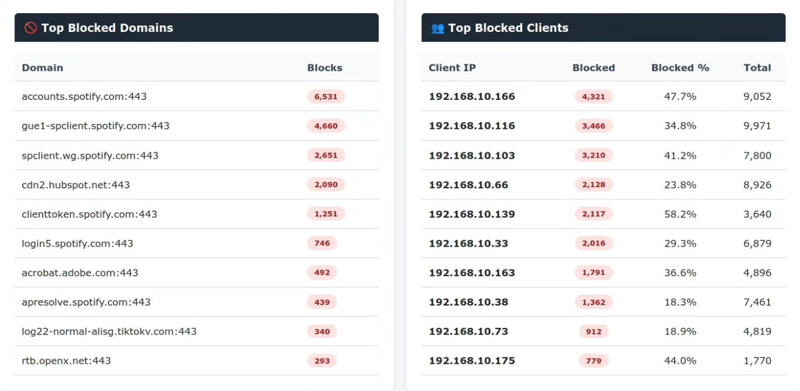</a>
</p>

| Description | Descripción |
| --- | --- |
| **Top Blocked Domains:** Shows the domains Squid blocks most often, along with the port and number of blocked requests. This helps identify frequently blocked sites or services and adjust access rules. | **Top Blocked Domains:** Muestra los dominios que Squid bloquea con mayor frecuencia, junto con el puerto y el número de solicitudes bloqueadas. Esta información ayuda a identificar qué sitios o servicios se bloquean más y a ajustar las reglas de acceso. |
| **Top Blocked Clients:** Shows the client IP addresses with the most blocked requests. Each row includes the total number of requests, how many were blocked, and the percentage they represent. This helps identify clients that often try to access restricted content and may need follow-up. | **Top Blocked Clients:** Muestra las IP de los clientes con más solicitudes bloqueadas. Cada fila incluye el total de solicitudes, cuántas se bloquearon y qué porcentaje representan. Esta información permite identificar equipos que requieren seguimiento por sus intentos de acceso a contenido restringido. |

#### Traffic by Client IP

<p align="center">
<a href="https://www.maravento.com/">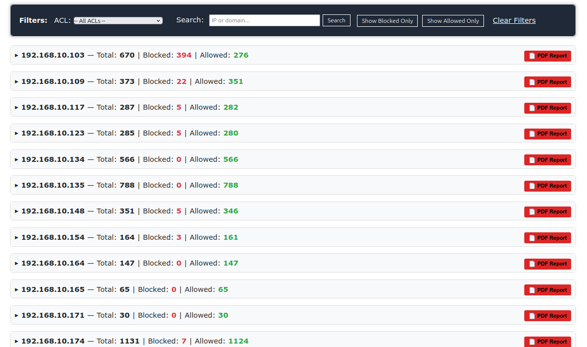</a>
</p>

| Description | Descripción |
| --- | --- |
| • Expand a client IP to view its traffic statistics, including total, blocked and allowed requests.<br><br>• Filter by ACL, search for IP addresses or domains, and select a period of 24 hours, 7 days or 30 days.<br><br>• Generate a PDF report for each client. | • Despliegue una IP para consultar el total de solicitudes y cuántas fueron bloqueadas o permitidas.<br><br>• Filtre por ACL, busque IP o dominios y seleccione períodos de 24 horas, 7 días o 30 días.<br><br>• Genere un informe PDF para cada cliente. |

#### Filtering and Search

<p align="center">
<a href="https://www.maravento.com/">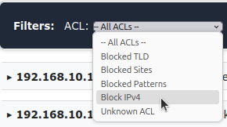</a>
</p>

| Description | Descripción |
| --- | --- |
| • Squidmon classifies traffic using ACLs (Access Control Lists), such as **Blocked TLD**, **Blocked Sites**, **Blocked Patterns**, **Block IPv4** and **Unknown ACL**. The last one covers rules defined in `squid.conf` that are not among the ACLs listed in **Config**.<br><br>• Search by IP address or domain, and filter to show only blocked or only allowed traffic.<br><br>• Select **Clean Filters** to clear the filters. | • Squidmon clasifica el tráfico según las ACL, como **Blocked TLD**, **Blocked Sites**, **Blocked Patterns**, **Block IPv4** y **Unknown ACL**. Esta última agrupa las reglas de `squid.conf` que no aparecen en la sección **Config**.<br><br>• Busque por IP o dominio y filtre para ver solo el tráfico bloqueado o solo el permitido.<br><br>• Pulse **Clean Filters** para borrar los filtros. |

#### Report Generation

<p align="center">
<a href="https://www.maravento.com/">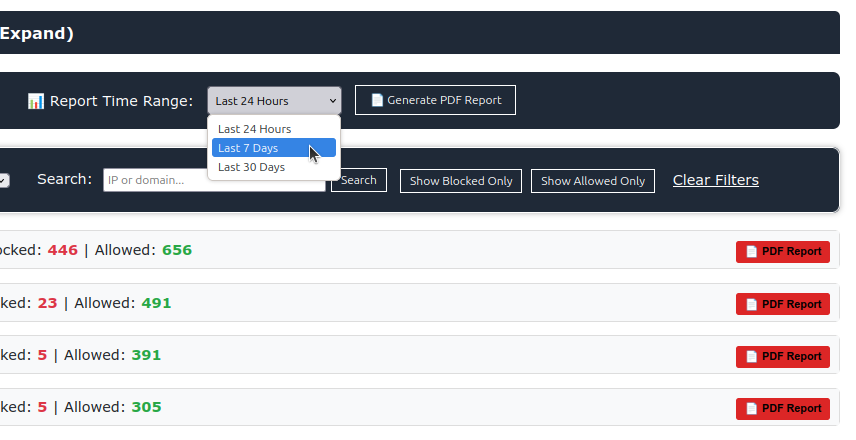</a>
</p>

| Description | Descripción |
| --- | --- |
| • Generate PDF traffic reports.<br><br>• Select the last 24 hours, 7 days or 30 days. You can also generate a report for a client or domain.<br><br>• The **Generate PDF Report** button appears in the interface. | • Genere informes PDF de tráfico.<br><br>• Seleccione las últimas 24 horas, los últimos 7 días o los últimos 30 días. También puede generar un informe para un cliente o dominio.<br><br>• El botón **Generate PDF Report** aparece en la interfaz. |

#### Blocked URLs Analysis

<p align="center">
<a href="https://www.maravento.com/">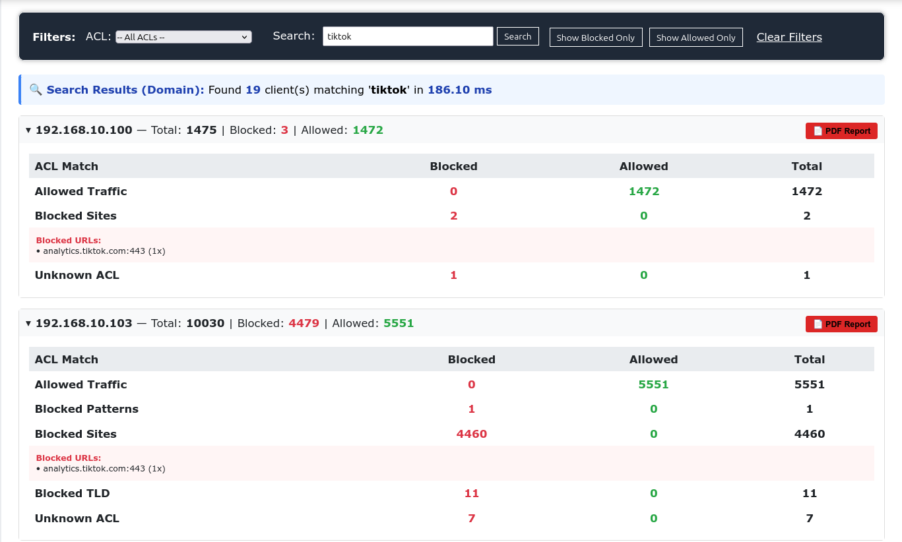</a>
</p>

<table width="100%">
  <tr>
    <td style="width: 50%; vertical-align: top;">
     Expand a client IP to see the blocked URLs, the matching ACL rule (for example, <b>Blocked Sites</b>), and how many times each URL was requested. This helps identify browsing patterns and adjust access rules.
    </td>
    <td style="width: 50%; vertical-align: top;">
     Al desplegar una IP, puede consultar las URL bloqueadas, la regla de ACL que coincidió —por ejemplo, <b>Blocked Sites</b>— y cuántas veces se solicitó cada URL. Estos datos ayudan a reconocer patrones de navegación y ajustar las reglas de acceso.
    </td>
  </tr>
</table>

#### Patterns

<p align="center">
<a href="https://www.maravento.com/">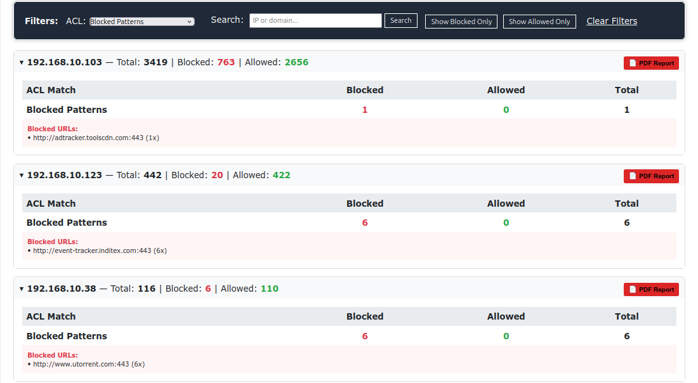</a>
</p>

<table width="100%">
  <tr>
    <td style="width: 50%; vertical-align: top;">
     If a Squid ACL uses <code>url_regex</code>, Squidmon cannot read it from a file. Enter the expression directly in the module's <b>Config</b> section, as shown here:
    </td>
    <td style="width: 50%; vertical-align: top;">
     Si una ACL de Squid usa <code>url_regex</code>, Squidmon no puede leerla desde un archivo. Copie su expresión directamente en la sección <b>Config</b> del módulo, como en este ejemplo:
    </td>
  </tr>
</table>

```bash
regex:(adlinkfly|announce\.php\?passkey=|info_hash|iptv|jndi:|mtc[0-9]|\.onion|peer_id=|porn|psiphon|torrent|ultrasurf)=Blocked Patterns
regex:^[0-9]{1,3}\.[0-9]{1,3}\.[0-9]{1,3}\.[0-9]{1,3}(:\d+)?(?=[/?#]|$)=Block IPv4
```

#### Squidmon Search

<p align="center">
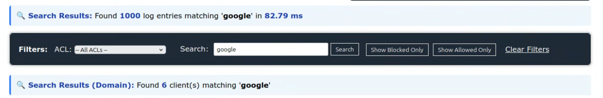
</p>

| Description | Descripción |
| --- | --- |
| • **Result:** 6 clients found in **0.08 seconds**. Client IP-based filtering with domain resolution.<br><br>• **Data source:** Squid access logs, `/var/log/squid/access.log`.<br><br>• **Search method:** Real-time log parsing with ACL filtering.<br><br>• **Use case:** Real-time client activity, immediate threat detection. | • **Resultado:** 6 clientes encontrados en **0,08 s**. Filtrado basado en IP del cliente con resolución de dominio.<br><br>• **Fuente de datos:** Registros de acceso de Squid, `/var/log/squid/access.log`.<br><br>• **Método de búsqueda:** Análisis de registros en tiempo real con filtrado ACL.<br><br>• **Caso de uso:** Actividad de cliente en tiempo real, detección inmediata de amenazas. |


#### Logrotate

<table width="100%">
  <tr>
    <td style="width: 50%; vertical-align: top;">
      <p>• Squidmon reads only the current <code>access.log</code>; it does not process rotated files. The same applies to Logview and SquidAI.<br><br>• Rotation in Proxymon is weekly. A rotation leaves <code>access.log</code> empty, so the modules lose the hours that moved to the rotated file. Weekly limits that gap to one day out of seven.<br><br>• Rotation always happens at 00:00, imposed by the <code>logrotate</code> timer. Do not configure <code>size</code> or <code>maxsize</code>: those split the current day, and Squidreports rebuilds each day from a single file.<br><br>• The installer also adds a <code>prerotate</code> hook to <code>/etc/logrotate.d/squid</code>. It closes the previous day's report before <code>access.log</code> is rotated. When that file already defines its own <code>prerotate</code>, the installer reports it and leaves it untouched.<br><br>• Disable Squid's internal rotation with <code>logfile_rotate 0</code>.<br><br>• In <code>/etc/logrotate.d/squid</code>, you can keep seven rotations with <code>rotate 7</code>.</p>
    </td>
    <td style="width: 50%; vertical-align: top;">
      <p>• Squidmon solo lee el <code>access.log</code> actual; no procesa los archivos rotados. Lo mismo ocurre con Logview y SquidAI.<br><br>• La rotación en Proxymon es semanal. Una rotación deja vacío el <code>access.log</code>, por lo que los módulos pierden las horas que pasaron al archivo rotado. La frecuencia semanal limita ese hueco a un día de cada siete.<br><br>• La rotación ocurre siempre a las 00:00, impuesta por el temporizador de <code>logrotate</code>. No configure <code>size</code> ni <code>maxsize</code>: parten el día en curso, y Squidreports reconstruye cada día a partir de un solo archivo.<br><br>• El instalador añade además un bloque <code>prerotate</code> a <code>/etc/logrotate.d/squid</code>. Cierra el informe del día anterior antes de rotar <code>access.log</code>. Si ese archivo ya define su propio <code>prerotate</code>, el instalador lo informa y no lo modifica.<br><br>• Desactive la rotación interna de Squid con <code>logfile_rotate 0</code>.<br><br>• En <code>/etc/logrotate.d/squid</code>, puede conservar siete rotaciones con <code>rotate 7</code>.</p>
    </td>
  </tr>
</table>

```bash
# Disable Squid internal rotation
sudo nano /etc/squid/squid.conf
#  TAG: logfile_rotate
logfile_rotate 0

# Logrotate (pmsetup.sh already sets weekly; this only restores it)
sudo sed -i -E 's/^([[:space:]]*)(hourly|daily|monthly|yearly)$/\1weekly/' /etc/logrotate.d/squid
# Optional:
sudo sed -i 's/rotate 2/rotate 7/' /etc/logrotate.d/squid
```

### REPORTS (Squidreports)

<p align="center">
<a href="https://www.maravento.com/">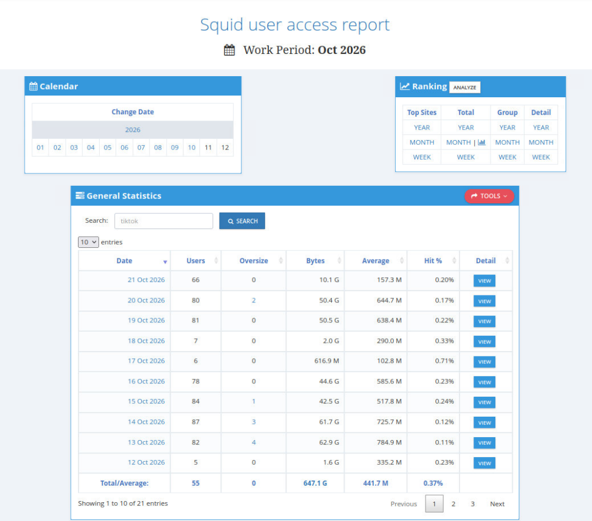</a>
</p>

<table width="100%">
  <tr>
    <td style="width: 50%; vertical-align: top;">
      <b>Squidreports</b> parses <code>access.log</code> and writes one folder per day under <code>/var/www/proxymon/squidreports/report/</code>. The daily view provides user details, top sites, large downloads and the additional reports described below.
    </td>
    <td style="width: 50%; vertical-align: top;">
      <b>Squidreports</b> analiza <code>access.log</code> y escribe una carpeta por día en <code>/var/www/proxymon/squidreports/report/</code>. La vista diaria permite consultar detalles por usuario, sitios más visitados, descargas grandes y los informes adicionales descritos a continuación.
    </td>
  </tr>
</table>

#### Initial Report

<table width="100%">
  <tr>
    <td style="width: 50%; vertical-align: top;">
     The first time you open <b>Reports</b>, reports may not be available yet. This happens if they have not been generated or your network traffic has not passed through Squid. The installer attempts to generate the initial report; if it does not appear, run this command:
    </td>
    <td style="width: 50%; vertical-align: top;">
     La primera vez que abra <b>Reports</b>, puede que todavía no haya informes. Esto ocurre si aún no se han generado o si el tráfico de la red no ha pasado por Squid. El instalador intenta generar el informe inicial; si no aparece, ejecute este comando:
    </td>
  </tr>
</table>

```bash
sudo /var/www/proxymon/squidreports/squidreports.pl today
```

#### Search Bar

<p align="center">
<a href="https://www.maravento.com/">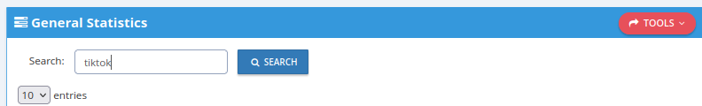</a>
</p>

<table width="100%">
  <tr>
    <td style="width: 50%; vertical-align: top;">
      In <b>General Statistics</b>, enter a word or value in the search bar and select <b>SEARCH</b>. The table will show matching rows, so you do not have to scan the entire report.
    </td>
    <td style="width: 50%; vertical-align: top;">
      En <b>General Statistics</b>, escriba una palabra o un valor en la barra de búsqueda y pulse <b>SEARCH</b>. La tabla mostrará las filas coincidentes, sin necesidad de recorrer todo el informe.
    </td>
  </tr>
</table>

<p align="center">
<a href="https://www.maravento.com/">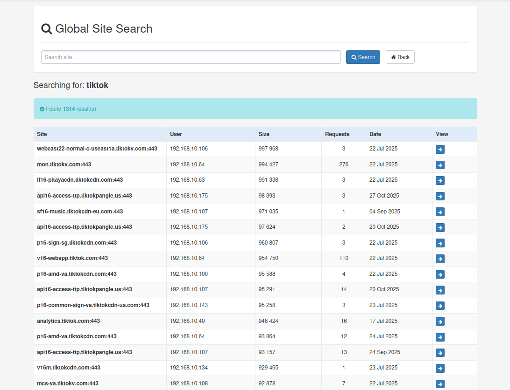</a>
</p>

#### Traffic Search

<p align="center">
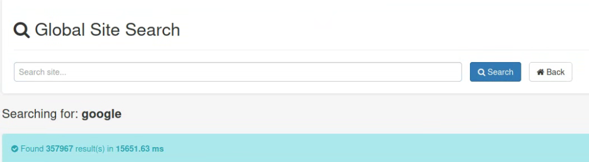
</p>

| Description | Descripción |
| --- | --- |
| • **Result:** 1,323 matches in **5.4 seconds**. Searches Squidreports daily reports for the entered term, regardless of letter case.<br><br>• **Data source:** Squidreports reports, `/var/www/proxymon/squidreports/report/YYYYMMDD/`.<br><br>• **Search method:** Reads report files and searches for the literal term.<br><br>• **Use case:** Historical analysis, domain trends, data usage reports. | • **Resultado:** 1 323 coincidencias en **5,4 s**. Busca el texto indicado en los informes diarios de Squidreports, sin distinguir mayúsculas de minúsculas.<br><br>• **Fuente de datos:** Informes de Squidreports, `/var/www/proxymon/squidreports/report/YYYYMMDD/`.<br><br>• **Método de búsqueda:** Lectura de los archivos de informes y búsqueda literal del término.<br><br>• **Caso de uso:** Análisis histórico, tendencias de dominios, informes de consumo de datos. |


#### Traffic Cron Job

<table width="100%">
  <tr>
    <td style="width: 50%; vertical-align: top;">
     The installer schedules Squidreports report generation every 10 minutes. To change the frequency, edit its entry in <code>/etc/cron.d/proxymon</code>. A second entry runs <code>yesterday</code> at 00:05, because <code>today</code> stops selecting the previous day at midnight. Its <code>--wait-lock</code> waits for the generator still running instead of giving up.
    </td>
    <td style="width: 50%; vertical-align: top;">
     El instalador programa la generación de informes de Squidreports cada 10 minutos. Para cambiar la frecuencia, edite su tarea en <code>/etc/cron.d/proxymon</code>. Una segunda tarea ejecuta <code>yesterday</code> a las 00:05, porque <code>today</code> deja de seleccionar el día anterior a medianoche. Su opción <code>--wait-lock</code> espera al generador que siga activo en lugar de abandonar.
    </td>
  </tr>
</table>

```bash
sudo nano /etc/cron.d/proxymon
*/10 * * * * www-data /var/www/proxymon/squidreports/squidreports.pl today
5 0 * * * www-data /var/www/proxymon/squidreports/squidreports.pl yesterday --wait-lock
```

#### Add Users

<table width="100%">
  <tr>
    <td style="width: 50%; vertical-align: top;">
     You can add users manually to <code>realname.cfg</code> and exclude IP addresses from reports with <code>skipuser.cfg</code>.
    </td>
    <td style="width: 50%; vertical-align: top;">
     Puede añadir usuarios manualmente a <code>realname.cfg</code> y excluir IP de los informes con <code>skipuser.cfg</code>.
     </td>
  </tr>
</table>

> When `UPDATE_REALNAME=true`—the default for a new installation—Bandata generates `realname.cfg` from non-excluded MAC ACLs and, when enabled, data from `uhm-auth.txt`. It also generates `skipuser.cfg` from the IP addresses in `mac-unlimited.txt` and IPv4 entries in `/etc/hosts`. If it finds data, it replaces the contents of those files, so manual edits may be lost.
>
> Cuando `UPDATE_REALNAME=true` —valor predeterminado al instalar—, Bandata genera `realname.cfg` con las ACL MAC no excluidas y, si corresponde, los datos de `uhm-auth.txt`. También genera `skipuser.cfg` con las IP de `mac-unlimited.txt` y las direcciones IPv4 de `/etc/hosts`. Si encuentra datos, reemplaza el contenido de esos archivos, por lo que los cambios manuales pueden perderse.

```bash
sudo nano /var/www/proxymon/squidreports/realname.cfg
# example:
192.168.X.2 Client1
192.168.X.24 Client12
sudo nano /var/www/proxymon/squidreports/skipuser.cfg
# example:
192.168.X.3 CEO
```

#### Groups

<p align="center">
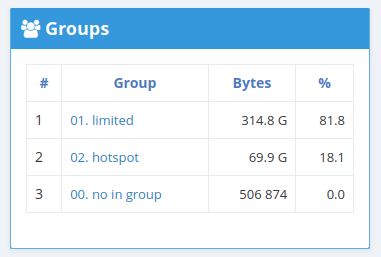
</p>

<table width="100%">
  <tr>
    <td style="width: 50%; vertical-align: top;">
      <p><strong>Group</strong> summarizes client traffic by ACL membership. When <code>UPDATE_REALNAME=true</code>, Bandata rebuilds <code>group.cfg</code> inside <code>SQUIDREPORTS_DIR</code> on each run. Active IPs from <code>ACL_MAC_PATH/mac-limited.txt</code> belong to <strong>01. limited</strong>. With <code>BANDATA_HOTSPOT=true</code>, active IPs from <code>HOTSPOT_PATH/acl/uhm-auth.txt</code> belong to <strong>02. hotspot</strong>. Only entries beginning with <code>a;</code> are included. Unlimited clients remain excluded from reports.</p>
      <p>The installer enables UHM integration when both <code>HOTSPOT_PATH/uhm.env</code> and <code>HOTSPOT_PATH/acl/uhm-auth.txt</code> exist. Without this integration, Bandata generates only the limited assignments. Clients recorded without an assignment appear as <strong>Not in group</strong>.</p>
      <p>Bandata replaces <code>group.cfg</code>, including when no active assignments remain, so manual edits are overwritten. Each generated daily report receives a copy in <code>.group</code>. Existing historical assignments remain unchanged until that date is regenerated. The installer option <code>update</code> preserves the installed file; Bandata updates it on its next run.</p>
    </td>
    <td style="width: 50%; vertical-align: top;">
      <p><strong>Group</strong> resume el tráfico de los clientes según su pertenencia a las ACL. Con <code>UPDATE_REALNAME=true</code>, Bandata reconstruye <code>group.cfg</code> dentro de <code>SQUIDREPORTS_DIR</code> en cada ejecución. Las IP activas de <code>ACL_MAC_PATH/mac-limited.txt</code> pertenecen a <strong>01. limited</strong>. Con <code>BANDATA_HOTSPOT=true</code>, las IP activas de <code>HOTSPOT_PATH/acl/uhm-auth.txt</code> pertenecen a <strong>02. hotspot</strong>. Solo se incluyen entradas que comienzan con <code>a;</code>. Los clientes unlimited siguen excluidos de los informes.</p>
      <p>El instalador habilita la integración con UHM cuando existen <code>HOTSPOT_PATH/uhm.env</code> y <code>HOTSPOT_PATH/acl/uhm-auth.txt</code>. Sin esta integración, Bandata genera únicamente las asignaciones limited. Los clientes registrados sin asignación aparecen como <strong>Not in group</strong>.</p>
      <p>Bandata reemplaza <code>group.cfg</code>, incluso cuando no quedan asignaciones activas, por lo que sobrescribe los cambios manuales. Cada informe diario generado recibe una copia en <code>.group</code>. Las asignaciones históricas existentes se conservan hasta regenerar esa fecha. La opción <code>update</code> del instalador conserva el archivo instalado; Bandata lo actualiza en su siguiente ejecución.</p>
    </td>
  </tr>
</table>

#### Exclude Users

<table width="100%">
  <tr>
    <td style="width: 50%; vertical-align: top;">
     To exclude IP addresses from reports, add them to <code>skipuser.cfg</code>. If <code>UPDATE_REALNAME=true</code>, Bandata normally rebuilds this file from <code>mac-unlimited.txt</code> and <code>/etc/hosts</code>, so manual changes may be replaced:
    </td>
    <td style="width: 50%; vertical-align: top;">
     Para excluir IP de los informes, añádalas a <code>skipuser.cfg</code>. Si <code>UPDATE_REALNAME=true</code>, Bandata normalmente vuelve a generar este archivo a partir de <code>mac-unlimited.txt</code> y <code>/etc/hosts</code>, por lo que puede reemplazar los cambios manuales:
    </td>
  </tr>
</table>

```bash
sudo nano /var/www/proxymon/squidreports/skipuser.cfg
# example
192.168.X.1
```

#### Netscan

<table width="100%">
  <tr>
    <td style="width: 50%; vertical-align: top;">
     Use one of the following tools to discover devices on your local network. Replace the example IP range where applicable:
    </td>
    <td style="width: 50%; vertical-align: top;">
     Utilice una de las siguientes herramientas para detectar dispositivos en su red local. Sustituya el rango de IP del ejemplo cuando corresponda:
    </td>
  </tr>
</table>

```bash
# Install required tools
sudo apt install -y nbtscan nmap arp-scan nast sudo netdiscover
# Run the following commands to scan your local network:
# 1. Using nbtscan
sudo nbtscan 192.168.X.0/24
# 2. Using nmap
sudo nmap -sn 192.168.X.0/24
# 3. Using arp-scan
sudo arp-scan --localnet
# 4. Using nast
sudo nast -m
# 5. Using netdiscover
sudo netdiscover
```

#### Report Data

<table width="100%">
  <tr>
    <td style="width: 50%; vertical-align: top;">
      <p>Squidreports preserves the base report formats and paths used by Bandata. Additional metrics are stored separately under <code>reportstats/YYYYMMDD/</code> (the configured report path followed by <code>stats</code>). Detail reads the original reports and these additional metrics. Existing additional metrics in old report folders remain readable until that date is regenerated. <strong>Analyze</strong> displays historical statistics and charts. Charts are generated on request, without saving images or HTML pages.</p>
    </td>
    <td style="width: 50%; vertical-align: top;">
      <p>Squidreports conserva los formatos y las rutas de los informes base utilizados por Bandata. Las métricas adicionales se guardan por separado en <code>reportstats/YYYYMMDD/</code> (la ruta configurada de informes seguida de <code>stats</code>). Detail lee los informes originales y estas métricas adicionales. Las métricas adicionales existentes en carpetas antiguas siguen siendo legibles hasta regenerar esa fecha. <strong>Analyze</strong> muestra estadísticas históricas y gráficos. Los gráficos se generan bajo petición, sin guardar imágenes ni páginas HTML.</p>
    </td>
  </tr>
</table>

#### Detailed Report

<p align="center">
<a href="https://www.maravento.com/">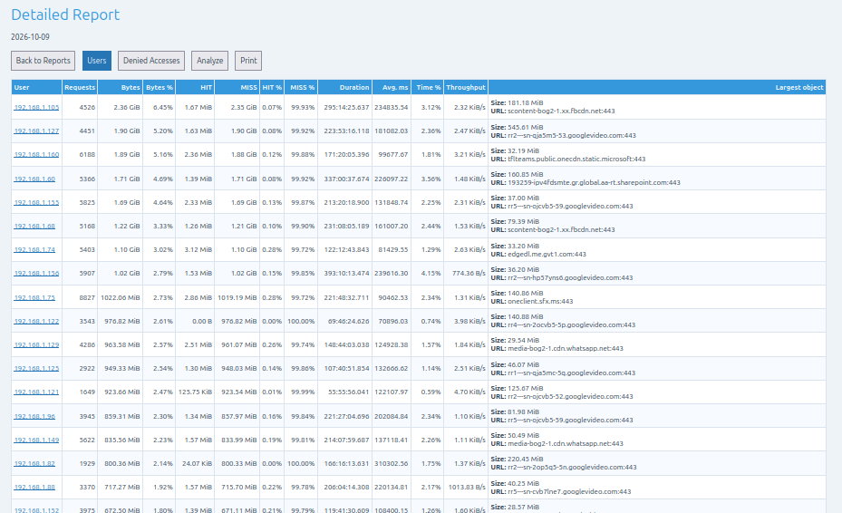</a>
</p>

| Description | Descripción |
| --- | --- |
| **Detailed Report** provides detailed traffic reports within Squidreports. It provides daily, weekly, monthly and yearly summaries, with details by user and site. | **Detailed Report** permite consultar informes detallados de tráfico dentro de Squidreports. Ofrece resúmenes diarios, semanales, mensuales y anuales, con detalles por usuario y sitio. |
| **Daily access:** In **General Statistics**, select **View** in the **Detail** column for the required date. The daily **User Statistics** link also opens this report when its metrics are available. | **Acceso diario:** En **General Statistics**, pulse **View** en la columna **Detail** de la fecha deseada. El enlace diario **User Statistics** también abre este informe cuando sus métricas están disponibles. |
| **Monthly and yearly access:** In the **Ranking** box, use **MONTH** or **YEAR** in the fourth column, **Detail**. These links open the detailed report for the selected period. | **Acceso mensual y anual:** En el cuadro **Ranking**, utilice **MONTH** o **YEAR** en la cuarta columna, **Detail**. Estos enlaces abren el informe detallado del período seleccionado. |
| **Weekly access:** In **Ranking**, **WEEK** opens weekly **Top Sites**, **Total**, **Group** or **Detail**. **Top Sites**, **Total** and **Group** retain their usual tables and tools. Choose the ISO week and either **Full week (Mon–Sun)** or **Bandata (Mon–Fri)**. The initial week comes from the latest daily report in the selected month or year. Reports read existing daily data and show missing dates explicitly. Bandata evaluates the previous Monday–Friday on Monday; the report shows consumption, not historical blocking status. **Detail** includes a daily breakdown for all users or the selected user/IP. | **Acceso semanal:** En **Ranking**, **WEEK** abre los informes semanales de **Top Sites**, **Total**, **Group** o **Detail**. **Top Sites**, **Total** y **Group** conservan sus tablas y herramientas habituales. Seleccione la semana ISO y **Full week (Mon–Sun)** o **Bandata (Mon–Fri)**. La semana inicial corresponde al último informe diario del mes o año seleccionado. Los informes leen los datos diarios existentes e indican las fechas ausentes. Bandata evalúa el lunes el período de lunes a viernes anterior; el informe muestra consumo, no el estado histórico de bloqueo. **Detail** incluye el desglose diario de todos los usuarios o del usuario/IP seleccionado. |
| **Users and IP addresses:** The initial table summarizes each user's requests, transferred bytes, consumption share, cache HIT/MISS bytes and percentages, accumulated duration, average request duration, time share, throughput and largest object with its URL. With the default configuration, unauthenticated traffic is identified by client IP; authenticated traffic uses the username. It does not create a separate IP breakdown for an authenticated user. | **Usuarios y direcciones IP:** La tabla inicial resume las solicitudes, bytes transferidos, porcentaje de consumo, bytes y porcentajes de caché HIT/MISS, duración acumulada, duración media por solicitud, porcentaje de tiempo, velocidad media y objeto de mayor tamaño con su URL. Con la configuración predeterminada, el tráfico sin autenticación se identifica por la IP del cliente; el autenticado utiliza el nombre de usuario. No crea un desglose independiente por IP para un usuario autenticado. |
| **Site details:** Select a user or IP address to view their sites for the same period. The table shows the same traffic, cache and duration metrics by site, excluding the largest-object column. **Users** returns to the summary for that period. | **Detalle por sitio:** Seleccione un usuario o una IP para consultar sus sitios durante el mismo período. La tabla muestra las mismas métricas de tráfico, caché y duración por sitio, sin la columna del objeto de mayor tamaño. **Users** vuelve al resumen del período. |
| **Denied Accesses:** Opens denied requests for the selected period and, when selected, the user. Each row shows the date, user or IP, time, Squid code and URL. This includes blocked requests and authentication failures recorded as denied by Squid. Denied requests remain outside the traffic totals. | **Denied Accesses:** Abre las solicitudes denegadas del período y, si se ha seleccionado, del usuario. Cada fila muestra fecha, usuario o IP, hora, código de Squid y URL. Incluye solicitudes bloqueadas y fallos de autenticación registrados como denegados por Squid. Las solicitudes denegadas se excluyen de los totales de tráfico. |
| **Metric interpretation:** Duration is the sum of request durations, not the user's connected time. Average request duration is expressed in milliseconds. Throughput divides transferred bytes by accumulated request duration; it is not a measurement of the network link's speed. | **Interpretación de métricas:** La duración es la suma de las duraciones de las solicitudes, no el tiempo de conexión del usuario. La duración media por solicitud se expresa en milisegundos. La velocidad media divide los bytes transferidos entre la duración acumulada; no mide la velocidad del enlace de red. |
| **Print and storage:** **Print** opens the browser's print dialog. Tables are generated from existing report data when opened; no duplicate HTML archive or graphs are stored. | **Impresión y almacenamiento:** **Print** abre el diálogo de impresión del navegador. Las tablas se generan desde los datos de los informes al consultarlas; no se almacena otro archivo histórico de HTML ni gráficos. |
| **Older reports:** Daily `.sitestat` files store cache and duration metrics by user/site under `reportstats/YYYYMMDD/`, separately from the original reports. Missing detailed metrics appear as **—**, rather than zero. Regenerate the affected dates from retained Squid logs to recover those metrics. | **Informes anteriores:** Los archivos diarios `.sitestat` guardan métricas de caché y duración por usuario/sitio en `reportstats/YYYYMMDD/`, separadas de los informes originales. Las métricas detalladas ausentes aparecen como **—**, en lugar de cero. Regenere las fechas afectadas desde los registros conservados de Squid para recuperar esas métricas. |

#### Analyze

<p align="center">
<a href="https://www.maravento.com/">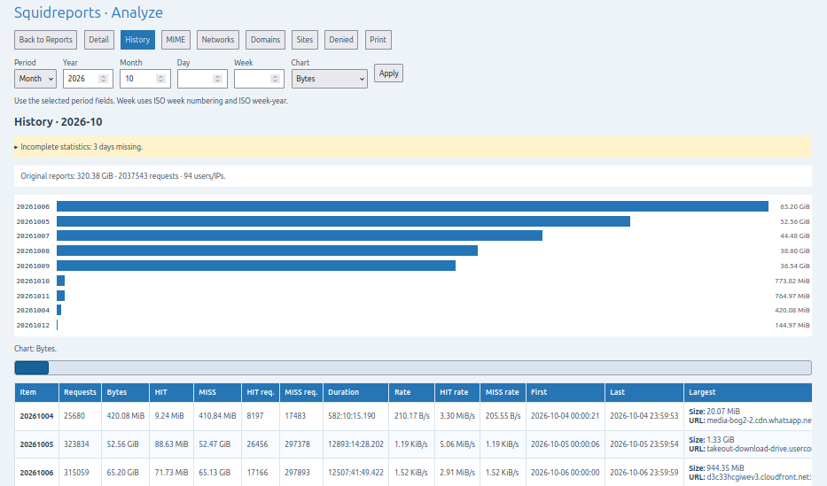</a>
</p>

| Description | Descripción |
| --- | --- |
| **Access:** Select **Analyze** beside the **Ranking** title or in **Detail**. This opens the analysis view within Squidreports. | **Acceso:** Pulse **Analyze** junto al título **Ranking** o dentro de **Detail**. Abre la vista de análisis dentro de Squidreports. |
| **Periods:** Select **Day**, **Week**, **Month** or **Year**, fill the corresponding fields and press **Apply**. Weeks use ISO numbering and the ISO week-year, which may include dates from the adjacent calendar year. **Detail** opens the same selected period. | **Períodos:** Seleccione **Day**, **Week**, **Month** o **Year**, complete los campos correspondientes y pulse **Apply**. Las semanas usan numeración ISO y el año de semana ISO, que puede incluir fechas del año calendario adyacente. **Detail** abre el mismo período seleccionado. |
| **History:** Displays recorded intervals by hour for a day, by day for a week or month, and by month for a year. Select bytes, requests, HIT/MISS bytes, throughput, HIT/MISS throughput or denied requests for the chart. The original report totals appear separately. Missing intervals are not filled with zero. | **History:** Muestra los intervalos registrados por hora para un día, por día para una semana o mes y por mes para un año. Permite graficar bytes, solicitudes, bytes HIT/MISS, velocidad media, velocidad HIT/MISS o solicitudes denegadas. Los totales de los informes originales aparecen por separado. Los intervalos ausentes no se completan con cero. |
| **MIME:** Aggregates content types for the selected period, with requests, bytes, cache, duration, throughput, first/last access and largest object. The type comes from Squid's log; HTTPS tunnels do not reveal their enclosed content. | **MIME:** Agrupa tipos de contenido para el período, con solicitudes, bytes, caché, duración, velocidad media, primer/último acceso y objeto de mayor tamaño. El tipo proviene del registro de Squid; los túneles HTTPS no revelan su contenido interno. |
| **Networks:** Groups client IPs by configured network, with traffic, cache, duration, throughput and largest object. Select a network to inspect its users/IPs. The main network comes from `RANGE` in `/etc/proxymon/proxymon.env`. Unmatched addresses remain individual. In `squidreports.cfg`, optional additional `$analytics_networks` entries use `[label, CIDR]`; IPv4 and IPv6 are supported. The longest matching prefix wins. | **Networks:** Agrupa IP de clientes por red configurada, con tráfico, caché, duración, velocidad media y objeto de mayor tamaño. Seleccione una red para consultar sus usuarios/IP. La red principal se lee de `RANGE` en `/etc/proxymon/proxymon.env`. Las direcciones sin coincidencia permanecen individuales. En `squidreports.cfg`, las entradas opcionales adicionales de `$analytics_networks` usan `[nombre, CIDR]`; admite IPv4 e IPv6. Prevalece el prefijo coincidente más específico. |
| **Domains and Sites:** **Domains** combines subdomains and opens their individual sites. **Sites** opens users for a destination; selecting a user shows their sites within the selected domain. Tables retain first/last access, cache, duration, throughput and largest object. Domain grouping uses the bundled Public Suffix List, including wildcard and exception rules. International suffixes are stored as ASCII/Punycode. Optional `$analytics_domain_suffixes` adds literal suffixes. | **Domains y Sites:** **Domains** agrupa subdominios y abre sus sitios individuales. **Sites** abre los usuarios de un destino; seleccionar un usuario muestra sus sitios dentro del dominio seleccionado. Las tablas conservan primer/último acceso, caché, duración, velocidad media y objeto de mayor tamaño. La agrupación utiliza la Public Suffix List incluida, con comodines y excepciones. Los sufijos internacionales se guardan en ASCII/Punycode. `$analytics_domain_suffixes` permite añadir sufijos literales. |
| **Denied:** Ranks denied destinations by request count. Each destination shows its users, Squid codes and first/last access. Includes authentication failures recorded as denied. These requests remain outside allowed-traffic totals. | **Denied:** Ordena los destinos denegados por cantidad de solicitudes. Cada destino muestra usuarios, códigos de Squid y primer/último acceso. Incluye fallos de autenticación registrados como denegados. Estas solicitudes se excluyen de los totales de tráfico permitido. |
| **Storage and coverage:** Original files stay in `REPORT_PATH/YYYYMMDD/`. Detail's additional files and Analyze's `analyzer.json` share `REPORT_STATS_PATH/YYYYMMDD/`, distinguished by filename. The parser replaces each day's aggregates when regenerating it. Dates missing additional metrics produce a coverage notice; regenerate them from retained logs. No additional pages or chart images are stored. | **Almacenamiento y cobertura:** Los archivos originales permanecen en `REPORT_PATH/YYYYMMDD/`. Los archivos adicionales de Detail y `analyzer.json` de Analyze comparten `REPORT_STATS_PATH/YYYYMMDD/`, separados por nombre. El parser reemplaza los agregados del día al regenerarlo. Las fechas sin métricas adicionales muestran un aviso de cobertura; regenérelas desde registros conservados. No se guardan páginas adicionales ni imágenes de gráficos. |
| **Tables and print:** Tables show 100 rows per page. Distribution charts show the first 20 rows; History charts show recorded intervals. **Print** prints the current page. Rates divide summed bytes by summed request durations; zero-duration rates appear as **—**. Internet cost calculation is excluded. | **Tablas e impresión:** Las tablas muestran 100 filas por página. Los gráficos de distribución muestran las primeras 20 filas; los históricos muestran los intervalos registrados. **Print** imprime la página actual. Las velocidades dividen los bytes acumulados entre las duraciones acumuladas; con duración cero aparece **—**. Se excluye el cálculo de costes de Internet. |

> Analyze reads the installed network configuration automatically; no example network needs copying. Additional network aliases remain optional in `squidreports.cfg`. Subnet statistics use the same configuration when regenerated.
>
> Analyze lee automáticamente la configuración de red instalada; no necesita copiar una red de ejemplo. Los alias adicionales siguen siendo opcionales en `squidreports.cfg`. Las estadísticas por subred usan la misma configuración al regenerarse.

#### Manual Public Suffix List update / Actualización manual de Public Suffix List

| Description | Descripción |
|---|---|
| Run `domain-suffixes-update.sh` manually as root. It is installed beside `domain-suffixes.txt`; no cron entry is added. | Ejecute `domain-suffixes-update.sh` manualmente como root. Se instala junto a `domain-suffixes.txt`; no se añade ninguna entrada de cron. |
| The updater loads `SQUIDREPORTS_DIR` from `/etc/proxymon/proxymon.env` through the shared reader. It does not assume the default web directory. Installation and update deploy the reader beside the updater. | El actualizador carga `SQUIDREPORTS_DIR` de `/etc/proxymon/proxymon.env` mediante el lector compartido. No presupone el directorio web predeterminado. La instalación y la actualización despliegan el lector junto al actualizador. |
| Downloads the official PSL over HTTPS, validates its metadata, ICANN and PRIVATE sections and every rule, and normalizes international suffixes to ASCII/Punycode. Preserves wildcard and exception rules. | Descarga la PSL oficial mediante HTTPS, valida sus metadatos, las secciones ICANN y PRIVATE y cada regla. Normaliza sufijos internacionales a ASCII/Punycode y conserva comodines y excepciones. |
| Replaces the list only after validation succeeds. Download or validation failures leave the previous list unchanged. An identical list is not rewritten. The configured directory must be root-owned and not writable by group or others. | Reemplaza la lista solo después de validarla. Los fallos de descarga o validación conservan la lista anterior. Una lista idéntica no se reescribe. El directorio configurado debe pertenecer a root, sin escritura para grupo u otros. |
| Logs to `/var/log/proxymon.log`. Requires `curl` and `python3`, included in installer dependencies. Project updates preserve the manually updated list. | Registra en `/var/log/proxymon.log`. Requiere `curl` y `python3`, incluidos en las dependencias del instalador. Las actualizaciones del proyecto conservan la lista actualizada manualmente. |

Default installation path / Ruta de instalación predeterminada:

~~~bash
sudo bash /var/www/proxymon/squidreports/domain-suffixes-update.sh
~~~

Use the updater under your configured `SQUIDREPORTS_DIR` if this path differs.

Utilice el actualizador situado en su `SQUIDREPORTS_DIR` configurado si utiliza otra ruta.

Official source / Fuente oficial: [Public Suffix List](https://publicsuffix.org/list/public_suffix_list.dat).

#### User Statistics

<table width="100%">
  <tr>
    <td style="width: 50%; vertical-align: top;">
      The daily <b>User Statistics</b> link opens <b>Detailed Report</b> when the daily metrics are available. It summarizes traffic, cache usage, request durations and the largest object for each user or client IP. Select a user or IP to inspect their sites.
    </td>
    <td style="width: 50%; vertical-align: top;">
      El enlace diario <b>User Statistics</b> abre <b>Detailed Report</b> cuando las métricas diarias están disponibles. Resume tráfico, uso de caché, duración de solicitudes y objeto de mayor tamaño por usuario o IP del cliente. Seleccione un usuario o una IP para consultar sus sitios.
    </td>
  </tr>
</table>

#### Traffic Classification

<table width="100%">
  <tr>
    <td style="width: 50%; vertical-align: top;">
      Traffic is grouped in three views: by content type, by file extension, and by client subnet. Each row gives the bytes, the number of requests and the share of the day's traffic. The three views share one page and differ only in the <code>type</code> parameter.
    </td>
    <td style="width: 50%; vertical-align: top;">
      El tráfico se agrupa en tres vistas: por tipo de contenido, por extensión de archivo y por subred del cliente. Cada fila muestra los bytes, el número de solicitudes y el porcentaje del tráfico del día. Las tres vistas comparten una página y solo cambian en el parámetro <code>type</code>.
    </td>
  </tr>
</table>

#### Denied Accesses

<table width="100%">
  <tr>
    <td style="width: 50%; vertical-align: top;">
      Lists requests denied by Squid during the day, with the user, time, Squid code and URL. It covers both the blocked requests, <code>TCP_DENIED/403</code>, and the authentication failures, <code>TCP_DENIED/407</code>. These lines never enter the traffic totals.
    </td>
    <td style="width: 50%; vertical-align: top;">
      Muestra las solicitudes rechazadas por Squid durante el día, con usuario, hora, código de Squid y URL. Incluye tanto las solicitudes bloqueadas, <code>TCP_DENIED/403</code>, como los fallos de autenticación, <code>TCP_DENIED/407</code>. Estas solicitudes se excluyen de los totales de tráfico.
    </td>
  </tr>
</table>

#### Data Statistics

<table width="100%">
  <tr>
    <td style="width: 50%; vertical-align: top;">
     Squidreports displays traffic statistics and identifies users who exceed the configured threshold. To change that threshold, edit <code>squidreports.cfg</code>:
    </td>
    <td style="width: 50%; vertical-align: top;">
     Squidreports muestra las estadísticas de tráfico y señala a los usuarios que superan el umbral configurado. Para cambiar ese umbral, edite <code>squidreports.cfg</code>:
    </td>
  </tr>
</table>

```bash
sudo nano /var/www/proxymon/squidreports/squidreports.cfg

# Nomenclature: 10 = 10 MBytes, 512 = 512 Mbytes, 1000 = 1 Gbytes...
# By default it comes in 1000. Do not modify the value 1024.

#user maximum size per day limit (oversize)
$perusertrafficlimit = 1000*1024*1024;
```

#### Export Tools

<p align="center">
<a href="https://www.maravento.com/">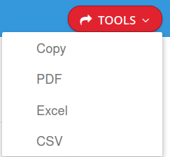</a>
</p>

<table width="100%">
  <tr>
    <td style="width: 50%; vertical-align: top;">
      In <b>General Statistics</b>, open <b>Tools</b> on the right side of the header to copy or print the table, or export it as PDF, XLSX, or CSV.
    </td>
    <td style="width: 50%; vertical-align: top;">
      En <b>General Statistics</b>, abra <b>Tools</b>, a la derecha del encabezado, para copiar o imprimir la tabla y exportarla como PDF, XLSX o CSV.
    </td>
  </tr>
</table>

#### Reports

<table width="100%">
  <tr>
    <td style="width: 50%; vertical-align: top;">
     Squidreports can export reports, but its site view shows a selection of top domains. To collect the domains recorded in the daily reports and create a list for a Squid ACL, run:
    </td>
    <td style="width: 50%; vertical-align: top;">
     Squidreports permite exportar informes, pero su vista de sitios muestra una selección de los dominios principales. Para reunir los dominios registrados en los informes diarios y generar una lista para una ACL de Squid, ejecute:
    </td>
  </tr>
</table>

```bash
find /var/www/proxymon/squidreports/report -type f -name '[0-9]*.[0-9]*.[0-9]*.[0-9]*' -exec grep -oE '[[:alnum:]_.-]+\.([[:alnum:]_.-]+)+' {} \; | sed 's/^\.//' | sed -r 's/^(www|ftp|ftps|ftpes|sftp|pop|pop3|smtp|imap|http|https)\.//g' | sed -r '/^[0-9]{1,3}(\.[0-9]{1,3}){3}$/d' | tr -d ' ' | awk '{print "." $1}' | sort -u > domains.txt
```

#### Bandata

<p align="center">
<a href="https://www.maravento.com/">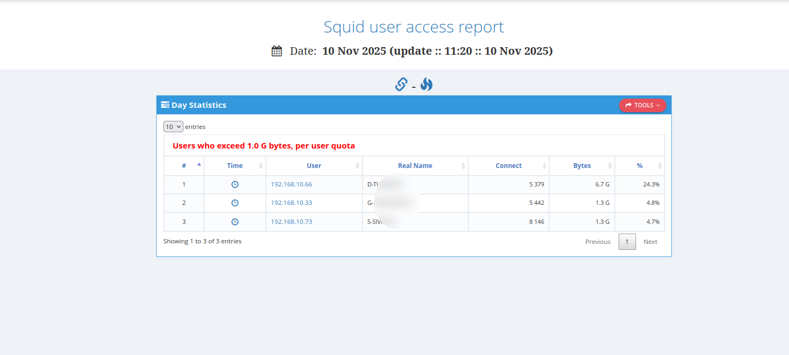</a>
</p>

<table width="100%">
  <tr>
    <td style="width: 50%; vertical-align: top;">
      <p>Bandata is a script that sets data usage limits —daily, weekly, and monthly— for IP addresses on a LAN monitored with Squid, and automatically blocks those that exceed the established quotas.<br><br>• Weekends are excluded from the calculation.<br><br>• The limits must match those configured in Squid Report.<br><br>• Bandata can generate <code>realname.cfg</code> to map IP addresses to names and <code>skipuser.cfg</code> to exclude IP addresses from Squidreports reports. It reads MAC ACLs, <code>/etc/hosts</code>, and, when enabled, the captive portal's <code>uhm-auth.txt</code>.<br><br>• On its first run Bandata writes <code>/etc/logrotate.d/bandata</code> if that file is missing, so <code>/var/log/bandata.log</code> never needs a manual truncate. The generated rule rotates the log daily, keeps seven rotations compressed, and recreates it as <code>640 root adm</code>. An existing file is left untouched, so your own changes are preserved.</p>
    </td>
    <td style="width: 50%; vertical-align: top;">
      <p>Bandata es un script que establece límites de consumo de datos —diario, semanal y mensual— para direcciones IP de una LAN monitorizada con Squid, y bloquea automáticamente aquellas que superan las cuotas establecidas.<br><br>• Los fines de semana quedan excluidos del cálculo.<br><br>• Los límites deben coincidir con los configurados en Squid Report.<br><br>• Bandata puede generar <code>realname.cfg</code> para asociar IP con nombres y <code>skipuser.cfg</code> para excluir IP de los informes de Squidreports. Toma los datos de las ACL MAC, de <code>/etc/hosts</code> y, si está activado, de <code>uhm-auth.txt</code> del portal cautivo.<br><br>• En su primera ejecución, Bandata crea <code>/etc/logrotate.d/bandata</code> si ese archivo no existe, por lo que <code>/var/log/bandata.log</code> nunca necesita un truncado manual. La regla generada rota el log a diario, conserva siete rotaciones comprimidas y lo recrea como <code>640 root adm</code>. Si el archivo ya existe, no lo modifica, por lo que sus cambios se conservan.</p>
    </td>
  </tr>
</table>

> Bandata calculates usage from available Squidreports reports. If reports are missing or incomplete, calculated usage may be lower than actual usage.
>
> Bandata calcula el consumo con los informes disponibles de Squidreports. Si faltan informes o están incompletos, el consumo calculado puede ser inferior al real.

> A failure never penalizes a client. When Bandata cannot read its reports, cannot build a list, or cannot publish its rules, it clears the affected blocks and logs a `WARNING: ... -alert`. The client regains access and the administrator investigates the cause. Missing report folders are not a failure: that case is reported as `INFO` and the quota is simply calculated over the days that exist.
>
> Una falla nunca penaliza al cliente. Cuando Bandata no puede leer sus informes, construir una lista o publicar sus reglas, vacía los bloqueos afectados y registra un `WARNING: ... -alert`. El cliente recupera el acceso y el administrador investiga la causa. La ausencia de carpetas de informes no es una falla: ese caso se informa como `INFO` y la cuota se calcula sobre los días que existen.

| Warning | When it appears | Cuándo aparece |
|---|---|---|
| `WARNING: banday.txt is missing` | The daily block list is absent when Bandata combines the three quota lists. The message names `banweek.txt` or `banmonth.txt` when that list is absent instead. | Falta la lista diaria al combinar las tres listas de bloqueos por cuota. El mensaje identifica `banweek.txt` o `banmonth.txt` cuando falta esa lista. |
| `WARNING: clearing all Bandata quota blocks -alert` | Bandata detects a list preparation, set preparation or IP loading failure. It then attempts to clear all quota blocks. This warning does not confirm successful removal. | Bandata detecta un fallo al preparar listas, preparar conjuntos o cargar IP. Después intenta retirar todos los bloqueos por cuota. El aviso no confirma su retirada. |

An unreadable file, a directory instead of a file, or a read error produces a different warning. The warning identifies the affected file; command failures also include the exit code.

Un archivo sin permiso de lectura, una carpeta o un error de lectura generan otro aviso. El aviso identifica el archivo afectado. Los fallos de comandos también incluyen su código de salida.

**Release of quota blocks after a failure / Liberación de bloqueos por cuota ante fallos**

The recovery mechanism clears the active `bandata` set to release all Bandata quota blocks. It runs when:

- A daily, weekly or monthly block list is missing, unreadable or not a regular file.
- Reading, sorting or deduplicating those lists fails.
- Creating `bandata` or `bandata_new`, or clearing `bandata_new`, fails.
- Adding an IP address to `bandata_new` fails.
- Clearing a quota list after a publication failure fails.
- Activating the new set with `ipset swap` fails; this branch logs its own warning.

El mecanismo de recuperación vacía el conjunto activo `bandata` para liberar todos los bloqueos por cuota. No retira bloqueos ajenos a Bandata. Se activa ante estos fallos:

- Falta una lista diaria, semanal o mensual, es ilegible o no es un archivo regular.
- Falla la lectura, la ordenación o la eliminación de duplicados de esas listas.
- Falla la creación de `bandata` o `bandata_new`, o el vaciado de `bandata_new`.
- Falla la incorporación de una IP a `bandata_new`.
- Falla el vaciado de una lista tras fallar su publicación.
- Falla la activación mediante `ipset swap`; esta ruta registra su propio aviso.

The warning announces recovery, not successful completion. Block removal depends on `ipset flush bandata` succeeding.

El aviso anuncia la recuperación, no su finalización. La liberación requiere que `ipset flush bandata` termine correctamente.

```text
# The day reports cannot be read
2026-10-17 12:00:00 WARNING: cannot read day reports, day cleared -alert

# A block list cannot be built from the reports
2026-10-17 12:00:00 WARNING: cannot build daily list, day cleared -alert
2026-10-17 12:00:00 WARNING: cannot build weekly list, week cleared -alert
2026-10-17 12:00:00 WARNING: cannot build monthly list, month cleared -alert

# The kernel set is incomplete or cannot be put in service
2026-10-17 12:00:00 WARNING: block set half loaded, all blocks cleared -alert
2026-10-17 12:00:00 WARNING: cannot activate new set, all blocks cleared -alert
```

**Scheduled execution / Ejecución programada**

```bash
# Bandata - Monitor bandwidth usage and enforce data limits (every 5 minutes)
sudo nano /etc/cron.d/proxymon
*/5 * * * * root /etc/proxymon/bandata/bandata.sh
```

**Terminal output example / Ejemplo de salida en terminal**

```bash
2026-10-19 15:59:56 bandata start...
2026-10-19 15:59:56 Running Bandata Day...
2026-10-19 15:59:56 INFO: Daily Blocked:
 192.168.0.86
2026-10-19 15:59:56 Running Bandata Week...
2026-10-19 15:59:57 INFO: Weekly Blocked:
 192.168.0.86
 192.168.0.101
 192.168.0.127
2026-10-19 15:59:57 Running Bandata Month...
2026-10-19 16:00:01 INFO: Monthly Blocked:
 192.168.0.60
 192.168.0.68
2026-10-19 16:00:01 Running Ipset/Iptables Rules...
2026-10-19 16:00:01 Applying Iptables Rules...
2026-10-19 16:00:01 INFO: group.cfg updated
2026-10-19 16:00:01 INFO: Quota rules applied; blocked IPs: 5
2026-10-19 16:00:01 bandata done at: 2026-10-19 16:00:01
```

##### Warning Portal

<p align="center">
<a href="https://www.maravento.com/">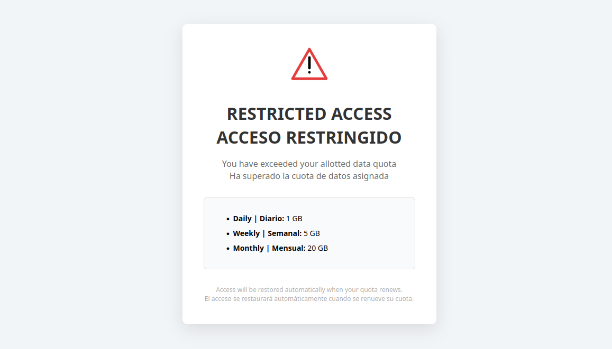</a>
</p>

<table width="100%">
  <tr>
    <td style="width: 50%; vertical-align: top;">
     When an IP address exceeds its daily, weekly, or monthly quota, Bandata redirects its HTTP traffic to the Warning portal. Other traffic is blocked:
    </td>
    <td style="width: 50%; vertical-align: top;">
     Cuando una IP supera su cuota diaria, semanal o mensual, Bandata redirige su tráfico HTTP al portal de advertencia (Warning) y bloquea el resto del tráfico:
    </td>
  </tr>
</table>

```bash
http://192.168.X.X:18081
```

##### Banned IPs

<table width="100%">
  <tr>
    <td style="width: 50%; vertical-align: top;">
     To view the blocked IP addresses:
    </td>
    <td style="width: 50%; vertical-align: top;">
     Para consultar las IP bloqueadas:
    </td>
  </tr>
</table>

```bash
cat /etc/proxymon/bandata/acl/{banmonth,banweek,banday}.txt | uniq
```

##### Data Limit

<table width="100%">
  <tr>
    <td style="width: 50%; vertical-align: top;">
     You can enter limits in gigabytes, megabytes, or bytes; for example, <code>0.5G</code>, <code>512M</code>, or <code>536870912</code>. The default limits are 1 GB per day, 5 GB per week, and 20 GB per month.
    </td>
    <td style="width: 50%; vertical-align: top;">
     Puede indicar los límites en gigabytes, megabytes o bytes; por ejemplo, <code>0.5G</code>, <code>512M</code> o <code>536870912</code>. Los valores predeterminados son 1 GB al día, 5 GB a la semana y 20 GB al mes.
    </td>
  </tr>
</table>

##### By Day

<table width="100%">
  <tr>
    <td style="width: 50%; vertical-align: top;">
     Bandata compares the day's usage with the daily limit and blocks IP addresses that exceed it. On each weekday run, it recalculates the daily list from that day's report; it clears the list on weekends. An IP address is no longer blocked by the daily quota once it disappears from that list, though it may remain blocked if it appears in the weekly or monthly list. To change the daily limit, edit <code>/etc/proxymon/proxymon.env</code>:
    </td>
    <td style="width: 50%; vertical-align: top;">
     Bandata compara el consumo del día con el límite diario y bloquea las IP que lo superan. En cada ejecución de lunes a viernes recalcula la lista diaria con el informe de ese día; durante el fin de semana la vacía. La IP deja de estar bloqueada por cuota diaria cuando desaparece de esa lista, aunque puede seguir bloqueada si aparece en la lista semanal o mensual. Para cambiar el límite diario, edite <code>/etc/proxymon/proxymon.env</code>:
    </td>
  </tr>
</table>

```bash
MAX_BANDWIDTH_DAY=1G
```

##### By Week

<table width="100%">
  <tr>
    <td style="width: 50%; vertical-align: top;">
     Every Monday, Bandata totals the usage recorded from Monday to Friday of the previous week and updates the weekly list. If an IP address exceeds the limit (5 GB by default), it remains blocked under the weekly quota until a later Monday calculation removes it from that list. It may also remain blocked if it appears in the daily or monthly list. To change the weekly limit, edit <code>/etc/proxymon/proxymon.env</code>:
    </td>
    <td style="width: 50%; vertical-align: top;">
     Cada lunes, Bandata suma el consumo registrado de lunes a viernes de la semana anterior y actualiza la lista semanal. Si una IP supera el límite —5 GB de forma predeterminada—, permanece bloqueada por cuota semanal hasta que el cálculo de un lunes posterior la quite de esa lista. También puede seguir bloqueada si aparece en la lista diaria o mensual. Para cambiar el límite semanal, edite <code>/etc/proxymon/proxymon.env</code>:
    </td>
  </tr>
</table>

```bash
MAX_BANDWIDTH_WEEK=5G
```

##### By Month

<table width="100%">
  <tr>
    <td style="width: 50%; vertical-align: top;">
     On every run, Bandata totals usage recorded on weekdays in the current month and updates the monthly list. If an IP address exceeds the limit (20 GB by default), it remains blocked under the monthly quota while it appears on that list. At the start of the next month, the list is calculated from the new month's reports, removing blocks that applied only to the previous month. The IP may remain blocked if it appears in the daily or weekly list. To change the monthly limit, edit <code>/etc/proxymon/proxymon.env</code>:
    </td>
    <td style="width: 50%; vertical-align: top;">
     En cada ejecución, Bandata suma el consumo de los días hábiles del mes en curso y actualiza la lista mensual. Si una IP supera el límite —20 GB de forma predeterminada—, permanece bloqueada por cuota mensual mientras figure en esa lista. Al comenzar el mes siguiente, la lista se calcula con los informes del nuevo mes y elimina los bloqueos que solo correspondían al mes anterior. La IP puede seguir bloqueada si aparece en la lista diaria o semanal. Para cambiar el límite mensual, edite <code>/etc/proxymon/proxymon.env</code>:
    </td>
  </tr>
</table>

```bash
MAX_BANDWIDTH_MONTH=20G
```

<table width="100%">
  <tr>
    <td style="width: 50%; vertical-align: top;">
      Bandata builds the blocked IP set by combining the daily, weekly, and monthly lists. An IP address is unblocked only when it no longer appears in any of the three.
    </td>
    <td style="width: 50%; vertical-align: top;">
      Bandata forma el conjunto de IP bloqueadas uniendo las listas diaria, semanal y mensual. Una IP deja de estar bloqueada cuando ya no aparece en ninguna de las tres.
    </td>
  </tr>
</table>

### LOGVIEW

<p align="center">
<a href="https://www.maravento.com/"></a>
</p>

<table width="100%">
  <tr>
    <td style="width: 50%; vertical-align: top;">
      <p><strong>Logview</strong> contains two internal tabs: <strong>Log</strong> for access logs and <strong>Live</strong> for active requests. Both views remain inside Logview. The Log/Live buttons share the controls row; the Log search field has a compact width.</p>
      <p>Dark is the default theme for Log and Live. The shared theme selection is saved in the browser and applied before displaying the content when Logview reloads. Live uses the same selection when opened, including when its refresh is paused.</p>
    </td>
    <td style="width: 50%; vertical-align: top;">
      <p><strong>Logview</strong> contiene dos pestañas internas: <strong>Log</strong> para los registros de acceso y <strong>Live</strong> para las solicitudes en curso. Ambas vistas permanecen dentro de Logview. Los botones Log/Live comparten la fila de controles; el campo de búsqueda de Log tiene un ancho reducido.</p>
      <p>El tema oscuro es el predeterminado de Log y Live. La selección de tema compartido se guarda en el navegador y se aplica antes de mostrar el contenido al recargar Logview. Live adopta esa selección al abrirse, incluso con su actualización pausada.</p>
    </td>
  </tr>
</table>

#### Log View

<p align="center">
<a href="https://www.maravento.com/">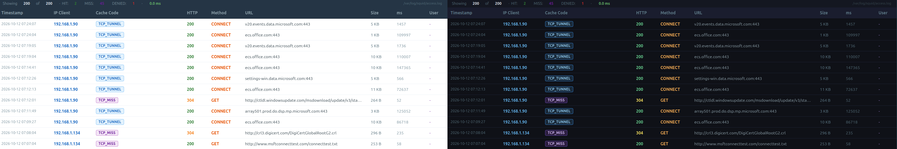</a>
</p>

| Control | Description | Descripción |
| --- | --- | --- |
|  | Shared theme toggle at the right of the dashboard header, beside the local date and time. Switches both views between light and dark themes. | Botón de tema compartido a la derecha de la cabecera, junto a la fecha y hora local. Alterna ambas vistas entre los temas claro y oscuro. |

| Description | Descripción |
| --- | --- |
| • **Log** opens by default and displays new entries from `/var/log/squid/access.log` in a table that refreshes periodically.<br><br>• Search the loaded entries, filter by cache code or HTTP status, and sort columns. | • **Log** abre por defecto y muestra las nuevas entradas de `/var/log/squid/access.log` en una tabla que se actualiza periódicamente.<br><br>• Puede buscar entre las entradas cargadas, filtrar por código de caché o estado HTTP y ordenar las columnas. |

##### Controls

| Message | Description | Descripción |
| ------- | ----------- | ----------- |
| 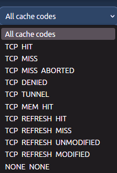 | Filters by Squid cache code: TCP_HIT (cached), TCP_MISS (origin), TCP_MISS_ABORTED (aborted), TCP_DENIED (blocked), TCP_TUNNEL (HTTPS), TCP_MEM_HIT (memory cache), TCP_REFRESH_HIT/MISS (revalidated), TCP_REFRESH_UNMODIFIED/MODIFIED (revalidation result), NONE_NONE (invalid/error request). | Filtra por código de caché de Squid: TCP_HIT (caché), TCP_MISS (origen), TCP_MISS_ABORTED (abortado), TCP_DENIED (bloqueado), TCP_TUNNEL (HTTPS), TCP_MEM_HIT (memoria), TCP_REFRESH_HIT/MISS (revalidado), TCP_REFRESH_UNMODIFIED/MODIFIED (resultado de revalidación), NONE_NONE (solicitud inválida/error). |
| 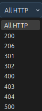 | Filters by HTTP response code: 200, 206, 301, 302, 400, 403, 404, 500. Color-coded: green (2xx), yellow (3xx), red (4xx/5xx). | Filtra por código de respuesta HTTP: 200, 206, 301, 302, 400, 403, 404, 500. Colores: verde (2xx), amarillo (3xx), rojo (4xx/5xx). |
| 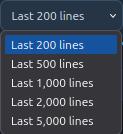 | Number of lines loaded from access.log on startup: 200, 500, 1,000, 2,000, or 5,000. | Número de líneas cargadas desde access.log al inicio: 200, 500, 1.000, 2.000 o 5.000. |
| 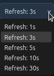 | Polling interval for new entries: 1s (default), 3s, 5s, 10s, or 30s. | Intervalo de sondeo para nuevas entradas: 1 s (predeterminado), 3 s, 5 s, 10 s o 30 s. |
|  | Automatic updates active in **Log**. New access.log entries appear at the top with a green animation. This indicator is separate from the **Live** tab. | Actualización automática activa en **Log**. Las nuevas entradas de access.log aparecen al principio con animación verde. Este indicador es independiente de la pestaña **Live**. |
| 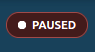 | Polling suspended. Indicator turns red and shows PAUSED. Click again to resume. | Sondeo suspendido. El indicador cambia a rojo y muestra PAUSED. Haga clic nuevamente para reanudar. |

##### Search Bar

<p align="center">
<a href="https://www.maravento.com/">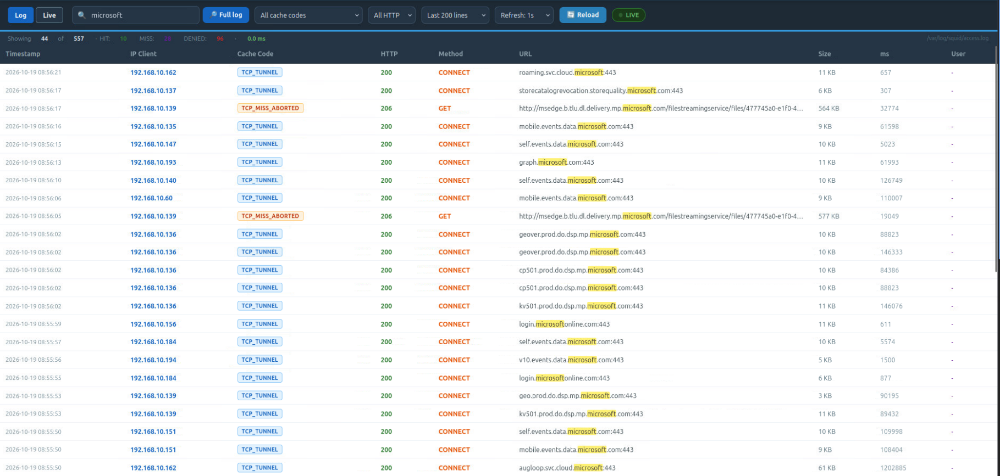</a>
</p>

<table width="100%">
  <tr>
    <td style="width: 50%; vertical-align: top;">
      The search bar filters loaded entries by IP address, URL, user, HTTP method, cache code, or HTTP response code.
    </td>
    <td style="width: 50%; vertical-align: top;">
      La barra filtra las entradas cargadas por IP, URL, usuario, método HTTP, código de caché o código de respuesta HTTP.
    </td>
  </tr>
</table>

| Message | Description | Descripción |
| ------- | ----------- | ----------- |
|  | Select this option to search the full log. | Seleccione esta opción para buscar en el registro completo. |
| 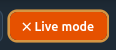 | Select this option to return to the live view. | Seleccione esta opción para volver a la vista en tiempo real. |

#### Live View

<p align="center">
<a href="https://www.maravento.com/">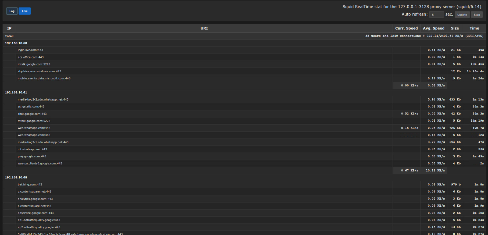</a>
</p>

| Description | Descripción |
| --- | --- |
| **Live** displays active Squid requests, grouped by client IP, current and average speeds, duration and speed subtotals. | **Live** muestra las solicitudes activas de Squid, agrupadas por IP de cliente, velocidad actual y media, duración y subtotales de velocidad. |
| Live queries Squid's Cache Manager using `SQUID_MGR_HOST`, `SQUID_MGR_PORT` and `SQUID_MGR_PASSWD` from `proxymon.env`. Refresh defaults to five seconds; Stop pauses it. Refresh is stored per browser session. | Live consulta el administrador de caché de Squid mediante `SQUID_MGR_HOST`, `SQUID_MGR_PORT` y `SQUID_MGR_PASSWD` de `proxymon.env`. Se actualiza cada cinco segundos por defecto; Stop pausa la actualización. El intervalo se conserva por sesión del navegador. |

| Control | Description | Descripción |
| --- | --- | --- |

### AI

<p align="center">
<a href="https://www.maravento.com/">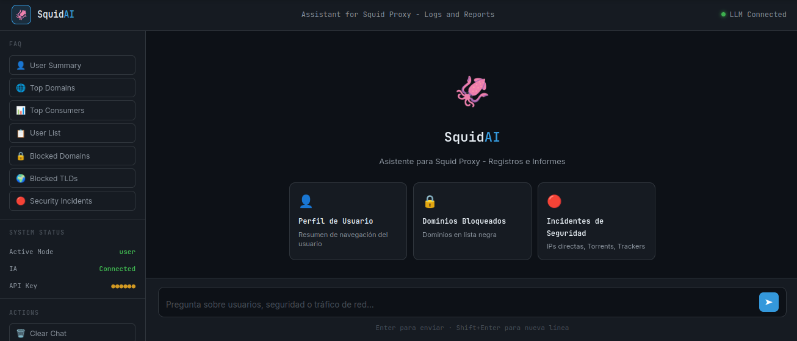</a>
</p>

<table width="100%">
  <tr>
    <td style="width: 50%; vertical-align: top;">
      <b>SquidAI</b> is an assistant for network administrators. It uses BM25 to find relevant information in its data and a language model (LLM) to respond in natural language. It combines data from Squid, Squidreports reports, and ACL lists to help answer questions about user profiles, blocked activity, incidents, and network usage:
      <ul>
        <li><b>User profiles:</b> Activity summary, most visited domains and blacklist verification for specific users.</li>
        <li><b>Security incidents:</b> Detection of requests sent directly to IP addresses, Torrent/P2P traffic, Log4Shell patterns, .onion sites and other suspicious behaviors.</li>
        <li><b>Blocked access:</b> Which IPs attempted to access blocked domains or TLDs.</li>
        <li><b>Network summary:</b> Top consumers, most visited domains, total data usage and unique IPs.</li>
        <li><b>Consumption thresholds:</b> Users exceeding specific GB limits (e.g. "more than 3 GB").</li>
        <li><b>User list:</b> Complete list of registered users from <code>realname.cfg</code> (excluding <code>skipuser.cfg</code>) of Squidreports.</li>
      </ul>
      The assistant responds in Spanish or English, matching the language of the question, and presents its findings in tables and detailed analyses.
    </td>
    <td style="width: 50%; vertical-align: top;">
      <b>SquidAI</b> es un asistente especializado para administradores de red. Usa BM25 para localizar información relevante en sus datos y un modelo de lenguaje (LLM) para responder en lenguaje natural. Combina respuestas basadas en datos de Squid, informes de Squidreports y listas ACL. Puede ayudar a consultar perfiles de usuario, actividad bloqueada, incidentes y consumo de la red:
      <ul>
        <li><b>Perfiles de usuario:</b> Resumen de actividad, dominios más visitados y verificación en lista negra para usuarios específicos.</li>
        <li><b>Incidentes de seguridad:</b> Detección de accesos directos a direcciones IP, tráfico Torrent/P2P, patrones Log4Shell, sitios .onion y otros comportamientos sospechosos.</li>
        <li><b>Accesos bloqueados:</b> Qué IP intentaron acceder a dominios o TLDs bloqueados.</li>
        <li><b>Resumen de red:</b> Principales consumidores, dominios más visitados, consumo total de datos e IP únicas.</li>
        <li><b>Umbrales de consumo:</b> Usuarios que superan límites específicos en GB (por ejemplo, "más de 3 GB").</li>
        <li><b>Lista de usuarios:</b> Lista completa de usuarios registrados desde <code>realname.cfg</code> (excluyendo <code>skipuser.cfg</code>) de Squidreports.</li>
      </ul>
      El asistente responde en español o inglés, según el idioma de la consulta, y presenta la información en tablas y análisis detallados.
    </td>
  </tr>
</table>

#### Examples

<table width="100%">
  <tr>
   <td style="width: 50%; vertical-align: top;">
      <b>User queries:</b><br>
      "Show me JOHN-SMITH activity"<br>
      "What did CARLOS-GARCIA do today?"<br>
      "Report for ACCOUNTING-DEPT"
    </td>
    <td style="width: 50%; vertical-align: top;">
      <b>Consultas de usuario:</b><br>
      "Muéstrame la actividad de JOHN-SMITH"<br>
      "¿Qué hizo CARLOS-GARCIA hoy?"<br>
      "Informe de CONTABILIDAD"
    </td>
  </tr>
  <tr>
    <td style="width: 50%; vertical-align: top;">
      <b>Network queries:</b><br>
      "Top 10 most visited domains today"<br>
      "Who consumes the most bandwidth?"<br>
      "Users who exceeded 3 GB"
    </td>
    <td style="width: 50%; vertical-align: top;">
      <b>Consultas de red:</b><br>
      "Top 10 dominios más visitados hoy"<br>
      "¿Quién consume más ancho de banda?"<br>
      "Usuarios que superaron 3 GB"
    </td>
  </tr>
  <tr>
    <td style="width: 50%; vertical-align: top;">
      <b>Security queries:</b><br>
      "Are there security incidents?"<br>
      "Detect any threat today?"<br>
      "Is there torrent traffic?"
    </td>
    <td style="width: 50%; vertical-align: top;">
      <b>Consultas de seguridad:</b><br>
      "¿Hay incidentes de seguridad?"<br>
      "¿Detectas alguna amenaza hoy?"<br>
      "¿Hay tráfico de torrents?"
    </td>
  </tr>
  <tr>
    <td style="width: 50%; vertical-align: top;">
      <b>Blocked accesses:</b><br>
      "Which IPs accessed blocked domains?"<br>
      "Show blocked TLD accesses"
    </td>
    <td style="width: 50%; vertical-align: top;">
      <b>Accesos bloqueados:</b><br>
      "¿Qué IPs accedieron a dominios bloqueados?"<br>
      "Muestra accesos a TLDs bloqueados"
    </td>
  </tr>
  <tr>
    <td style="width: 50%; vertical-align: top;">
      <b>User list:</b><br>
      "List all registered users"<br>
      "Show me all users"
    </td>
    <td style="width: 50%; vertical-align: top;">
      <b>Lista de usuarios:</b><br>
      "Lista todos los usuarios registrados"<br>
      "Muéstrame todos los usuarios"
    </td>
  </tr>
</table>

> The user names in the examples are illustrative. For the assistant to recognize them, they must exist in `realname.cfg` (and not be excluded in `skipuser.cfg`), where Squidreports stores the IP-to-hostname mapping.
>
> Los nombres de usuario en los ejemplos son ilustrativos. Para que el asistente los reconozca, deben existir en `realname.cfg` (y no estar excluidos en `skipuser.cfg`), donde Squidreports almacena la correspondencia entre IP y nombres de equipo.

#### Security Incidents

##### ⚠️ Warning

<table width="100%">
  <tr>
    <td style="width: 50%; vertical-align: top;">
      For security incident detection, SquidAI uses <code>/etc/acl/squid/blockpatterns.txt</code> and direct IPv4 detection. Severity depends on the pattern type and number of matches; results can be classified as <b>CRITICAL</b>, <b>HIGH</b>, <b>MEDIUM</b>, or <b>LOW</b>.
    </td>
    <td style="width: 50%; vertical-align: top;">
      Para la detección de incidentes de seguridad, SquidAI utiliza <code>/etc/acl/squid/blockpatterns.txt</code> y detección de IPv4 directa. La severidad depende del tipo de patrón y del número de coincidencias; los resultados pueden clasificarse como <b>CRITICAL</b>, <b>HIGH</b>, <b>MEDIUM</b> o <b>LOW</b>.
    </td>
  </tr>
</table>

#### API Configuration

<table width="100%">
  <tr>
    <td style="width: 50%; vertical-align: top;">
      <b>🔧 API Setup:</b> SquidAI requires an LLM provider to function. The configuration file is located outside the webroot for security:
      <pre><code>sudo nano /etc/proxymon/.env</code></pre>
      <code>/etc/proxymon/</code> contains two files: <code>.env</code> (SquidAI LLM credentials) and <code>proxymon.env</code> (shared Proxy Monitor configuration, including Bandata network and quota settings). Do not confuse them.
      Set your provider URL, API key and response format:
      <pre><code>LLM_URL=https://your-provider.com/endpoint
LLM_API_KEY=your_api_key
LLM_MODEL=model-name
LLM_RESPONSE_FORMAT=openai</code></pre>
    </td>
    <td style="width: 50%; vertical-align: top;">
      <b>🔧 Configuración de API:</b> SquidAI requiere un proveedor LLM para funcionar. El archivo de configuración se encuentra fuera del webroot por seguridad:
      <pre><code>sudo nano /etc/proxymon/.env</code></pre>
      <code>/etc/proxymon/</code> contiene dos archivos: <code>.env</code> (credenciales LLM de SquidAI) y <code>proxymon.env</code> (configuración compartida de Proxy Monitor, incluidas la red y las cuotas de Bandata). No los confunda.
      Configure la URL del proveedor, la clave de API y el formato de respuesta:
      <pre><code>LLM_URL=https://su-proveedor.com/endpoint
LLM_API_KEY=su_api_key
LLM_MODEL=nombre-del-modelo
LLM_RESPONSE_FORMAT=openai</code></pre>
    </td>
  </tr>
  <tr>
    <td style="width: 50%; vertical-align: top;">
      The URL format depends on the provider.
      <ul>
        <li>Some providers include the account ID or the model name in the URL, for example Cloudflare: <code>…/accounts/ACCOUNT_ID/ai/run/MODEL_NAME</code>.</li>
        <li>Others use a fixed URL with the model in <code>LLM_MODEL</code>, for example OpenAI and Groq.</li>
        <li>Others embed the API key as a URL parameter, for example Gemini: <code>…?key=YOUR_KEY</code>.</li>
      </ul>
      Check the commented examples in the <code>.env</code> file for each provider's exact format. Leave <code>LLM_MODEL</code> empty if the model is already part of the URL.
    </td>
    <td style="width: 50%; vertical-align: top;">
      El formato de la URL depende del proveedor.
      <ul>
        <li>Algunos proveedores incluyen el identificador de cuenta o el nombre del modelo en la URL, por ejemplo Cloudflare: <code>…/accounts/ACCOUNT_ID/ai/run/NOMBRE_MODELO</code>.</li>
        <li>Otros usan una URL fija con el modelo en <code>LLM_MODEL</code>, por ejemplo OpenAI y Groq.</li>
        <li>Otros incrustan la clave de API como parámetro de la URL, por ejemplo Gemini: <code>…?key=SU_CLAVE</code>.</li>
      </ul>
      Consulte los ejemplos comentados del archivo <code>.env</code> para ver el formato exacto de cada proveedor. Deje <code>LLM_MODEL</code> vacío si el modelo ya forma parte de la URL.
    </td>
  </tr>
  <tr>
    <td style="width: 50%; vertical-align: top;">
      <code>LLM_RESPONSE_FORMAT</code> tells the worker how to read the response: <code>openai</code> (most providers), <code>ollama</code> (local Ollama), or <code>gemini</code> (Google Gemini passthrough).
    </td>
    <td style="width: 50%; vertical-align: top;">
      <code>LLM_RESPONSE_FORMAT</code> indica al worker cómo leer la respuesta: <code>openai</code> (la mayoría de proveedores), <code>ollama</code> (Ollama local) o <code>gemini</code> (Google Gemini passthrough).
    </td>
  </tr>
  <tr>
    <td style="width: 50%; vertical-align: top;">
      The file includes commented examples for: <b>Cloudflare Workers AI</b>, <b>OpenAI</b>, <b>Groq</b>, <b>OpenRouter</b>, <b>Together AI</b>, <b>Ollama</b> (local), <b>LM Studio</b> (local) and <b>Google Gemini</b>. Uncomment one block and fill in your credentials.
    </td>
    <td style="width: 50%; vertical-align: top;">
      El archivo incluye ejemplos comentados para: <b>Cloudflare Workers AI</b>, <b>OpenAI</b>, <b>Groq</b>, <b>OpenRouter</b>, <b>Together AI</b>, <b>Ollama</b> (local), <b>LM Studio</b> (local) y <b>Google Gemini</b>. Descomente un bloque y complete sus credenciales.
    </td>
  </tr>
  <tr>
    <td style="width: 50%; vertical-align: top;">
      <b>🔒 Security:</b> The <code>.env</code> file is stored in <code>/etc/proxymon/</code>, outside the Apache webroot. Permissions are set to <code>640</code> (<code>root:www-data</code>), allowing root and processes in the <code>www-data</code> group, including Apache PHP, to read the file.
    </td>
    <td style="width: 50%; vertical-align: top;">
      <b>🔒 Seguridad:</b> El archivo <code>.env</code> se almacena en <code>/etc/proxymon/</code>, fuera del webroot de Apache. Los permisos son <code>640</code> (<code>root:www-data</code>): el archivo queda accesible para root y para los procesos del grupo <code>www-data</code>, incluido PHP de Apache.
    </td>
  </tr>
  <tr>
    <td style="width: 50%; vertical-align: top;">
      <b>🔄 Rate Limits &amp; Retries:</b> LLM APIs may experience congestion depending on demand. SquidAI implements an automatic retry mechanism: up to <b>4 attempts</b> with progressive delays (4s, 8s, 15s) before giving up. If the API is temporarily unavailable, the assistant will display retry messages. If all attempts fail, it displays the notice shown in the following table.
    </td>
    <td style="width: 50%; vertical-align: top;">
      <b>🔄 Límites de solicitudes y reintentos:</b> Las APIs LLM pueden experimentar congestión según la demanda. SquidAI implementa un mecanismo de reintento automático: hasta <b>4 intentos</b> con esperas progresivas (4 s, 8 s y 15 s) antes de desistir. Si la API no está disponible temporalmente, el asistente mostrará mensajes de reintento. Si todos los intentos fallan, mostrará el aviso de la tabla siguiente.
    </td>
  </tr>
</table>

| Message | Description | Descripción |
| ------- | ----------- | ----------- |
|  | Example of the automatic retry message. | Ejemplo del mensaje de reintento automático. |
| 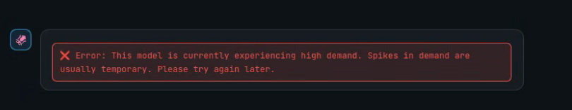 | Example shown when the API is unavailable. | Ejemplo de API no disponible. |

#### LLM Status

<table width="100%">
  <tr>
    <td style="width: 50%; vertical-align: top;">
    <b>🔌 LLM Status:</b> The LED indicates whether the connection is checking, connected, or offline.
    </td>
    <td style="width: 50%; vertical-align: top;">
    <b>🔌 Estado LLM:</b> El LED indica si la conexión se está verificando, está conectada o está fuera de línea.
    </td>
  </tr>
</table>

| Message | Description | Descripción |
| ------- | ----------- | ----------- |
|  | Checking LLM connection | Verificando conexión con el LLM |
|  | LLM connected and ready | LLM conectado y listo |
|  | LLM unreachable or offline | LLM inaccesible o fuera de línea |

### TOOLS

<table width="100%">
  <tr>
    <td style="width: 50%; vertical-align: top;">
      <p>Command-line utilities are installed in <code>/etc/proxymon/tools</code> and run from a terminal. The HTML reports they generate can be viewed from the panel.</p>
    </td>
    <td style="width: 50%; vertical-align: top;">
      <p>Las utilidades de consola se instalan en <code>/etc/proxymon/tools</code> y se ejecutan desde la terminal. Los informes HTML que generan se pueden consultar desde el panel.</p>
    </td>
  </tr>
</table>

#### Squidtool

<table width="100%">
  <tr>
    <td style="width: 50%; vertical-align: top;">
      <p>Squidtool is a command-line utility with two functions: generate a traffic report and search Squid logs. Run it with:</p>
    </td>
    <td style="width: 50%; vertical-align: top;">
      <p>Squidtool es una utilidad de consola con dos funciones: generar un informe de tráfico y buscar términos en los registros de Squid. Se ejecuta con:</p>
    </td>
  </tr>
</table>

```bash
sudo /etc/proxymon/tools/squidtool.sh
```

> Each function generates an HTML report and replaces the previous report of the same type, so only the latest result is kept. The reports are written to `TOOL_REPORT_DIR` (`/etc/proxymon/tools/reports` by default), outside the Apache webroot, and the panel serves them read-only under the same loopback-only restriction. Tool activity is logged beside the script (`CONFIG_DIR/tools/squidtool.log`).
>
> Cada función genera un informe HTML y reemplaza el anterior del mismo tipo; solo se conserva el resultado más reciente. Los informes se escriben en `TOOL_REPORT_DIR` (`/etc/proxymon/tools/reports` por defecto), fuera del webroot de Apache, y el panel los publica en modo lectura con la misma restricción a loopback. La herramienta registra su actividad junto al script (`CONFIG_DIR/tools/squidtool.log`).

##### Traffic Report

<p align="center">
<a href="https://www.maravento.com/">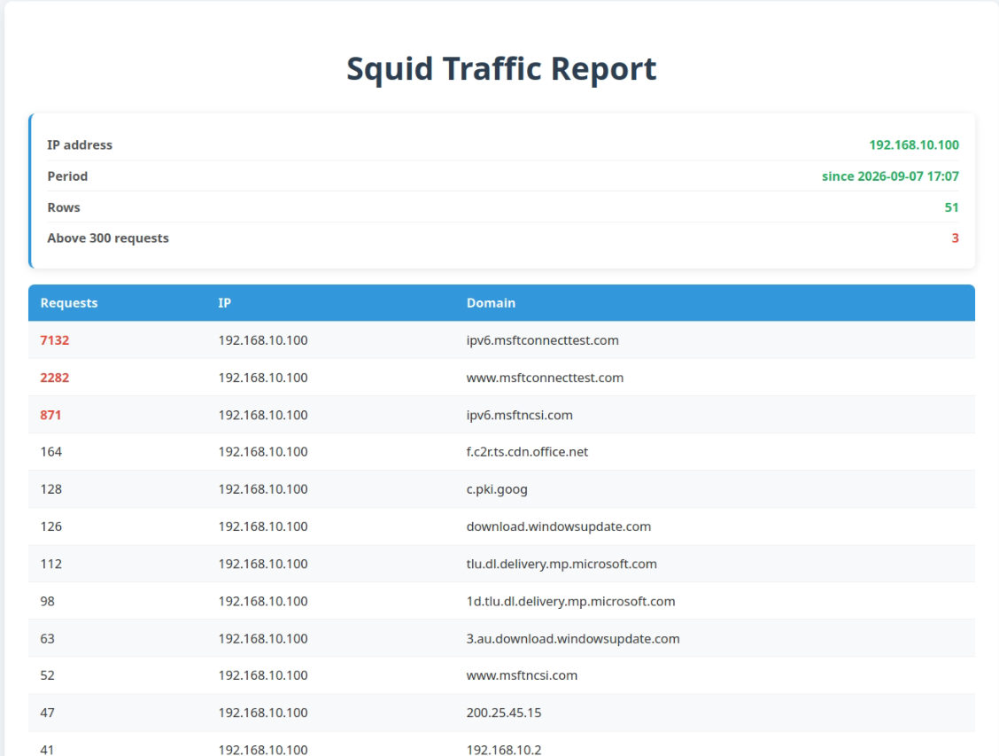</a>
</p>

<table width="100%">
  <tr>
    <td style="width: 50%; vertical-align: top;">
      <p>Analyzes the requests recorded by Squid, grouping them by <strong>client IP and requested domain</strong>. It allows selecting a single IP or analyzing every IP, and defining the period to review. The analysis covers the current <code>access.log</code> and its rotated or compressed files. Requests are counted and sorted from the most active to the least. When every IP is analyzed, entries below 20 requests are excluded. Entries reaching or exceeding 300 requests are shown as alerts. The result is written to <code>squid_traffic.html</code>.</p>
    </td>
    <td style="width: 50%; vertical-align: top;">
      <p>Analiza las solicitudes registradas por Squid, agrupándolas por <strong>IP de cliente y dominio solicitado</strong>. Permite seleccionar una IP concreta o analizar todas las IP y definir el período que se desea revisar. El análisis incluye el <code>access.log</code> actual y sus archivos rotados o comprimidos. Las solicitudes se contabilizan y se ordenan de mayor a menor actividad. Cuando se analizan todas las IP, se excluyen las entradas con menos de 20 solicitudes. Las entradas que alcanzan o superan las 300 solicitudes se muestran como alertas. El resultado se genera en <code>squid_traffic.html</code>.</p>
    </td>
  </tr>
</table>

##### Log Search

<p align="center">
<a href="https://www.maravento.com/">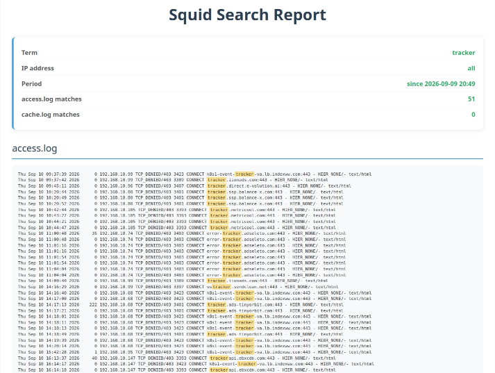</a>
</p>

<table width="100%">
  <tr>
    <td style="width: 50%; vertical-align: top;">
      <p>• Searches for a <strong>specific term</strong> in the <code>access.log</code> and <code>cache.log</code> records, without distinguishing between uppercase and lowercase. The text is matched literally, not as a regular expression, so characters such as <code>?</code>, <code>&amp;</code>, <code>=</code> or <code>*</code> are searched as typed. The search includes the current, rotated and compressed files. In <code>access.log</code> it allows filtering by <strong>client IP</strong> and setting the search period. In <code>cache.log</code> the IP filter does not apply, because that record does not contain the client IP. The results from <code>access.log</code> and <code>cache.log</code> are shown separately, along with the number of matches found in each record. The result is written to <code>squid_search.html</code>.<br><br>• For <code>cache.log</code> to record the ACL decisions -- which rule allowed or blocked each request -- Squid must have <code>debug_options ALL,1 33,2 28,9</code> enabled in <code>squid.conf</code>. Without it the search still works, but that record only holds the usual service messages. Keep in mind that this directive makes <code>cache.log</code> grow considerably.</p>
    </td>
    <td style="width: 50%; vertical-align: top;">
      <p>• Busca un <strong>término específico</strong> en los registros <code>access.log</code> y <code>cache.log</code>, sin distinguir entre mayúsculas y minúsculas. El texto se busca de forma literal, no como expresión regular, de modo que caracteres como <code>?</code>, <code>&amp;</code>, <code>=</code> o <code>*</code> se buscan tal cual se escriben. La búsqueda incluye los archivos actuales, rotados y comprimidos. En <code>access.log</code> permite filtrar por <strong>IP de cliente</strong> y establecer el período de búsqueda. En <code>cache.log</code> no se aplica el filtro por IP porque este registro no contiene la IP del cliente. Los resultados de <code>access.log</code> y <code>cache.log</code> se muestran por separado, junto con la cantidad de coincidencias encontradas en cada registro. El resultado se genera en <code>squid_search.html</code>.<br><br>• Para que <code>cache.log</code> registre las decisiones de ACL -- qué regla permitió o bloqueó cada solicitud -- Squid debe tener activada la directiva <code>debug_options ALL,1 33,2 28,9</code> en <code>squid.conf</code>. Sin ella la búsqueda sigue funcionando, pero ese registro solo contendrá los mensajes habituales del servicio. Tenga en cuenta que esa directiva hace crecer <code>cache.log</code> de forma considerable.</p>
    </td>
  </tr>
</table>

#### pmbk

<table>
  <tr>
    <td style="width: 50%; vertical-align: top;">
      <code>pmbk.sh</code> creates a ZIP archive with the Proxy Monitor installation and configuration, including the paths listed below:
      <ul>
        <li>The project install tree, <code>/var/www/proxymon</code>, and <code>/etc/proxymon</code>.</li>
        <li>The MAC and Squid ACL lists.</li>
        <li>The Bandata ACL directory and its quota lists.</li>
        <li>The Apache vhosts and the Apache and PHP hardening files.</li>
        <li>The <code>bandata</code> logrotate configuration.</li>
        <li>The project's <code>/etc/cron.d/proxymon</code> entry and the <code>php.ini</code> in use.</li>
      </ul>
      Paths that do not exist are skipped. Only the last 3 archives are kept. <code>pmsetup.sh --update</code> runs this backup before updating project files.
    </td>
    <td style="width: 50%; vertical-align: top;">
      <code>pmbk.sh</code> crea un archivo ZIP con la instalación y configuración de Proxy Monitor, incluidas las rutas que se enumeran a continuación:
      <ul>
        <li>El árbol de instalación del proyecto, <code>/var/www/proxymon</code>, y <code>/etc/proxymon</code>.</li>
        <li>Las listas ACL de MAC y de Squid.</li>
        <li>El directorio ACL de Bandata y sus listas de cuota.</li>
        <li>Los hosts virtuales de Apache y los archivos de protección de Apache y PHP.</li>
        <li>La configuración de logrotate de <code>bandata</code>.</li>
        <li>La entrada <code>/etc/cron.d/proxymon</code> del proyecto y el <code>php.ini</code> en uso.</li>
      </ul>
      Las rutas que no existan se omiten. Solo se conservan los 3 últimos archivos. <code>pmsetup.sh --update</code> ejecuta esta copia de seguridad antes de actualizar los archivos del proyecto.
    </td>
  </tr>
</table>

| Command | Description | Descripción |
|---|---|---|
| `sudo bash pmbk.sh` | Create a backup now | Crear una copia ahora |
| `sudo bash pmbk.sh --install` | Register the `@monthly` cron entry | Registrar la entrada mensual en cron |
| `sudo bash pmbk.sh --uninstall` | Remove the cron entry, keeping the archives | Quitar la entrada de cron, conservando los archivos ZIP |

> Backs up Proxymon into `BACKUP_DIR/pmbk_<YYYYMMDD_HHMMSS>.zip` (`BACKUP_DIR=/etc/bak/proxymon` by default), keeping up to 3 archives. `pmsetup.sh --install` registers the monthly cron entry automatically; `pmsetup.sh --uninstall` removes it before removing the project. Restore with `sudo unzip -X ARCHIVE.zip -d /` to recover the stored Unix ownership and permissions. Validate the archive in an isolated directory before restoring.
>
> Respalda Proxymon en `BACKUP_DIR/pmbk_<YYYYMMDD_HHMMSS>.zip` (`BACKUP_DIR=/etc/bak/proxymon` por defecto), conservando hasta tres archivos ZIP. `pmsetup.sh --install` registra la entrada mensual de cron automáticamente; `pmsetup.sh --uninstall` la elimina antes de quitar el proyecto. Restaure con `sudo unzip -X ARCHIVO.zip -d /` para recuperar propietarios y permisos Unix almacenados. Valide el archivo en un directorio aislado antes de restaurar.

### PROXYMON LOGS

> Project log: `/var/log/proxymon.log`. Installation and update configure daily rotation in `/etc/logrotate.d/proxymon`, keeping seven previous files plus the active log. Compression starts on the next rotation. Empty logs are not rotated; missing logs are tolerated. Squid and Apache keep their own policies.
>
> Log del proyecto: `/var/log/proxymon.log`. La instalación y la actualización configuran rotación diaria en `/etc/logrotate.d/proxymon`. Se conservan siete archivos anteriores y el activo. La compresión comienza en la siguiente rotación. Los logs vacíos no se rotan; los ausentes se toleran. Squid y Apache conservan sus propias políticas.


```bash
/var/log/apache2/proxymon_access.log
/var/log/apache2/proxymon_error.log
/var/log/bandata.log                 # Rotated via /etc/logrotate.d/bandata
pmsetup.log                          # In pmsetup.sh's own directory, rewritten on each run
/etc/proxymon/tools/squidtool.log    # In squidtool.sh's own directory, rewritten on each run
```

#### Message examples

> Processing messages keep their timestamp and have no level or flag. `STATUS` is a viewer label, not text written in the log. Three trailing dots are reserved for these lines; other messages have no final period.
>
> Los mensajes de procesamiento conservan la fecha y no llevan nivel ni flag. `STATUS` es una etiqueta del visor; no se escribe en el log. Los tres puntos finales se reservan para estas líneas; los demás mensajes no llevan punto final.

> Independent examples from different executions / Ejemplos independientes de diferentes ejecuciones.

```text
2026-10-17 12:00:00 Updating PHP...
2026-10-17 12:00:00 INFO: blockpatterns.txt: download failed; retry 2/3
2026-10-17 12:00:00 WARNING: blockpatterns.txt download failed -alert
2026-10-17 12:00:00 WARNING: pmbk.sh: monthly backup setup failed -alert
```

## ORIGINAL PROJECTS

---

<table width="100%">
  <tr>
    <td style="width: 50%; vertical-align: top;">
      <p>Part of <strong>Proxy Monitor</strong> reimplements selected functions from LightSquid, SARG, SqStat and SquidAnalyzer. These open-source tools no longer receive support or updates (EOL/EOS).</p>
      <p>We extend our special thanks to the developers who created these remarkable tools and devoted their time to building them. Without this foundation, the development of Proxy Monitor would not have been possible.</p>
    </td>
    <td style="width: 50%; vertical-align: top;">
      <p>Una parte de <strong>Proxy Monitor</strong> reimplementa funciones de LightSquid, SARG, SqStat y SquidAnalyzer. Estas herramientas de código abierto ya no reciben soporte ni actualizaciones (EOL/EOS).</p>
      <p>Agradecemos especialmente a los programadores que crearon estas magníficas herramientas y dedicaron su tiempo a desarrollarlas. Sin esta base, el desarrollo de Proxy Monitor no habría sido posible.</p>
    </td>
  </tr>
</table>

| Original project / Developer | Last Official Version | Unofficial Update | Additional | Reimplemented in |
| :--------------------------: | :-------------------: | :---------------: | :--------: | :--------------: |
| **LightSquid** | [v1.8-7 (2009)](https://lightsquid.sourceforge.net/) | [v1.8.1 (2021)](https://github.com/finisky/lightsquid-1.8.1) | [Metro_tpl @semofajardo (2020)](https://www.sysadminsdecuba.com/2020/09/lightsquid/) | `squidreports` |
| **SARG** | [v2.4.0 (2020-01-16)](https://sourceforge.net/projects/sarg/) | N/A | N/A | `squidreports` |
| [Sqstat - Alex Samorukov](https://web.archive.org/web/20251212064719/http://samm.kiev.ua/sqstat/) | [v1.20 (2006)](https://sourceforge.net/projects/sqstat/files/) | N/A | N/A | `logview` |
| [SquidAnalyzer](https://squidanalyzer.darold.net/download.html) [github](https://github.com/darold/squidanalyzer) | [v6.6 (2017)](https://sourceforge.net/projects/squid-report/files/squid-report/6.6/) | N/A | N/A | `squidreports` |

## ⚠️ WARNING: NETWORK ACCESS

---

<table>
  <tr>
    <td style="width: 50%; vertical-align: top;">
      This project is designed for use on a local network (LAN). It does not include the security hardening needed for direct exposure to the internet. If internet access is required, an on-demand tunnel is recommended instead of opening ports directly. This enables access when needed without leaving the server permanently exposed.
    </td>
    <td style="width: 50%; vertical-align: top;">
      Este proyecto está diseñado para usarse en una red local (LAN). No cuenta con las medidas de seguridad necesarias para exponerlo directamente a Internet. Si se requiere acceso desde Internet, se recomienda utilizar un túnel bajo demanda en lugar de abrir puertos directamente. Así, el acceso se habilita cuando hace falta y el servidor no queda expuesto permanentemente.
    </td>
  </tr>
</table>

**Optional tunnel:**
- [Cloudflare Tunnel with Zero Trust Recommended](https://raw.githubusercontent.com/maravento/vault/master/scripts/bash/cftunnel.sh)

## NOTICE

---

<table width="100%">
  <tr>
    <td style="width: 50%; vertical-align: top;">
      <strong>This repository</strong>
      <ul>
        <li>May include third-party components.</li>
        <li>Does not accept Pull Requests. Changes must be proposed via Issues.</li>
        <li>This project does not support backward compatibility. New versions may require configuration changes or reinstallation.</li>
      </ul>
    </td>
    <td style="width: 50%; vertical-align: top;">
      <strong>Este repositorio</strong>
      <ul>
        <li>Puede incluir componentes de terceros.</li>
        <li>No acepta Pull Requests. Los cambios deben proponerse mediante Issues.</li>
        <li>Este proyecto no soporta retrocompatibilidad. Las nuevas versiones pueden requerir cambios de configuración o una reinstalación.</li>
      </ul>
    </td>
  </tr>
</table>

## SPONSOR THIS PROJECT

---

[](https://paypal.me/maravento)

## PROJECT LICENSES

---

<table width="100%">
  <tr>
    <td style="width: 50%; vertical-align: top;">
      This project uses a dual-licensing model to balance software freedom with content protection:
    </td>
    <td style="width: 50%; vertical-align: top;">
      Este proyecto utiliza un modelo de licencia dual para equilibrar la libertad del software con la protección del contenido:
    </td>
  </tr>
</table>

| Content | Licensed Under |
|---|---|
|Scripts, Binaries, Infrastructure|[](LICENSE)|
|RAG, Workers, Specialized Modules, Docs|[](docs/LICENSE-CC-BY-NC-ND-4.0.md)|

## DISCLAIMER

---

THE SOFTWARE IS PROVIDED "AS IS", WITHOUT WARRANTY OF ANY KIND, EXPRESS OR IMPLIED, INCLUDING BUT NOT LIMITED TO THE WARRANTIES OF MERCHANTABILITY, FITNESS FOR A PARTICULAR PURPOSE AND NONINFRINGEMENT. IN NO EVENT SHALL THE AUTHORS OR COPYRIGHT HOLDERS BE LIABLE FOR ANY CLAIM, DAMAGES OR OTHER LIABILITY, WHETHER IN AN ACTION OF CONTRACT, TORT OR OTHERWISE, ARISING FROM, OUT OF OR IN CONNECTION WITH THE SOFTWARE OR THE USE OR OTHER DEALINGS IN THE SOFTWARE.
